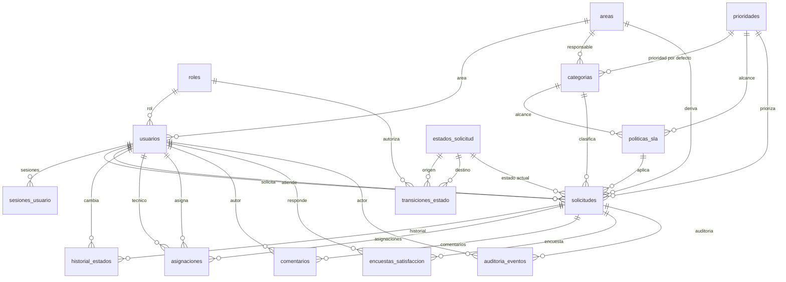

# DISEÑO-BD.md — Base de datos MySQL del Sistema de Servicios Universitarios

> **Proyecto:** Sistema Web Inteligente para la Gestión Integral de Servicios Universitarios (Gestal).
> **Motor:** MySQL 8.4.13 (imagen `mysql:8.4.13` de `compose.yaml`).
> **Base de datos:** `uni_services`.
> **Estado:** diseño propuesto, pendiente de implementación con Flyway en `backend-uni`.
> **Fuentes:** `docs/requirements/user-stories/HU-01` a `HU-20`, `docs/requirements/Gestal_Requisitos_Funcionales.md`, `docs/requirements/Gestal_Requisitos_No_Funcionales.md`, `docs/EPICS.md`, `docs/ARCHITECTURE.md`, `compose.yaml` y `docs/DOCKER.md`.
> **Última actualización:** 2026-11-02.

---

## 1. Resumen ejecutivo

El modelo cubre los seis módulos del sistema: autenticación y roles, registro y seguimiento de solicitudes, ciclo de vida y asignaciones, dashboard, administración de catálogos y SLA/auditoría/encuesta.

La pieza central es `solicitudes`. A su alrededor se agrupan:

- **Seguridad:** `roles`, `usuarios`, `sesiones_usuario`.
- **Catálogos:** `areas`, `prioridades`, `categorias`, `estados_solicitud`, `transiciones_estado`, `politicas_sla`.
- **Ciclo de vida:** `historial_estados`, `asignaciones`, `comentarios`, `encuestas_satisfaccion`.
- **Soporte:** `auditoria_eventos`, `secuencias_codigo_solicitud`.

El diseño prioriza:

1. **Trazabilidad:** cada cambio de estado, asignación y campo relevante deja historial o auditoría.
2. **Integridad histórica:** los catálogos y usuarios se desactivan; no se eliminan físicamente.
3. **Reglas explícitas:** la máquina de estados vive en `transiciones_estado`, no en código hardcodeado.
4. **Consultas rápidas:** índices compuestos alineados con “mis solicitudes”, bandeja del área, bandeja del técnico, SLA y dashboard.
5. **Compatibilidad MySQL 8.4:** InnoDB, `utf8mb4`, checks nativos, columnas generadas e índices únicos.

---

## 2. Alcance y fuentes

### 2.1. Historias cubiertas

| Épica | Historias | Necesidad principal |
| --- | --- | --- |
| EP-01 | HU-01, HU-02 | Login/logout, roles y autorización. |
| EP-02 | HU-03, HU-04, HU-05, HU-06 | Registrar, listar, detallar, historiar y comentar solicitudes. |
| EP-03 | HU-07, HU-08, HU-09, HU-10, HU-11 | Filtrar por área, asignar/reasignar, atender, cerrar y rechazar. |
| EP-04 | HU-12, HU-13, HU-14 | Indicadores, filtros y exportación. |
| EP-05 | HU-15, HU-16, HU-17 | Usuarios, áreas, categorías, prioridades y estados. |
| EP-06 | HU-18, HU-19, HU-20 | SLA, auditoría y encuesta de satisfacción. |

### 2.2. Fuera de alcance del esquema

- **Adjuntos/evidencias:** ninguna HU actual exige carga de archivos. Se deja una tabla opcional documentada en la sección 14.
- **Notificaciones, correo, chat o tiempo real:** no aparecen en las HU aprobadas.
- **Datos personales reales:** los seeds solo contienen catálogos; no se insertan usuarios con contraseñas por defecto.
- **Reportes exportados:** HU-14 no requiere persistencia; se resuelve con consultas y descarga directa.

---

## 3. Decisiones de diseño

| # | Decisión | Justificación | Alternativa descartada |
| --- | --- | --- | --- |
| D-01 | Ciclo de vida de las HU: `Nuevo → Asignado → En proceso → Resuelto → Cerrado`, con `Rechazado` como final alternativo. | Las HU, RF-13, RF-14, RF-15 y los escenarios BDD son la fuente funcional. `ARCHITECTURE.md` se corrige para que coincida. | El ciclo `Registrada → En evaluación → Asignada → En atención → Resuelta → Cerrada` de la versión anterior de `ARCHITECTURE.md`. |
| D-02 | Identificadores en español `snake_case`. | Coherencia con el dominio, los documentos y el equipo; se corrige `ARCHITECTURE.md`. | Identificadores en inglés. |
| D-03 | Un rol por usuario (`usuarios.rol_id`). | HU-15 habla de “asignarles un rol y un área”; no se requiere multi-rol. | Tabla puente `usuarios_roles`. |
| D-04 | La solicitud guarda `area_id` como copia del área de la categoría. | HU-07 exige filtrar por área del supervisor; si la categoría cambia de área, la solicitud conserva el área con la que fue registrada. | Calcular el área siempre con `JOIN categorias`. |
| D-05 | La prioridad inicial se toma de `categorias.prioridad_predeterminada_id`. | HU-03 CA-03 y RF-05. | Prioridad fija global. |
| D-06 | La máquina de estados se define en `transiciones_estado` con rol y `requiere_motivo`. | RF-15 y HU-10/HU-11; evita `if` hardcodeados y permite administrar reglas. | Validar transiciones solo en el servicio. |
| D-07 | Una sola asignación activa por solicitud, garantizada con columna generada + índice único. | HU-08 y HU-09; evita dos técnicos activos por error. | Validación solo en aplicación. |
| D-08 | La reasignación conserva el estado actual. | Decisión del equipo: no se pierde el avance “En proceso”. | Volver a `Asignado` en cada reasignación. |
| D-09 | El SLA se congela en la solicitud (`politica_sla_id`, `fecha_limite_sla`, `fecha_aviso_sla`). | HU-18; cambiar una política no debe alterar solicitudes ya creadas. | Calcular el SLA siempre contra la política vigente. |
| D-10 | `historial_estados` es la línea de tiempo visible; `auditoria_eventos` es el registro de cumplimiento. | HU-05/HU-10 piden historial; HU-19/RF-22 piden campo, valor anterior y valor nuevo. | Usar solo auditoría para reconstruir la línea de tiempo. |
| D-11 | Catálogos y usuarios se desactivan (`activo = 0`), no se eliminan. | HU-15 y HU-16; preserva integridad histórica y evita romper FKs. | Borrado físico con `ON DELETE CASCADE`. |
| D-12 | `sesiones_usuario` permite revocar sesiones en logout. | HU-01 CA-04 exige invalidar la sesión activa. | JWT sin revocación del lado servidor. |
| D-13 | Fechas en `DATETIME(6)` UTC. | Evita el límite 2038 de `TIMESTAMP` y conserva microsegundos. | `TIMESTAMP`. |
| D-14 | PKs surrogate `BIGINT UNSIGNED`. | Consistencia con `Long` de JPA y margen para auditoría/historial. | PKs naturales o `INT UNSIGNED`. |

---

## 4. Convenciones MySQL

| Elemento | Convención |
| --- | --- |
| Motor | `InnoDB` en todas las tablas. |
| Charset | `utf8mb4`. |
| Collation | `utf8mb4_0900_ai_ci` (nativa de MySQL 8.4, insensible a mayúsculas y acentos). |
| PK | `BIGINT UNSIGNED AUTO_INCREMENT`. Excepción: `secuencias_codigo_solicitud.anio`. |
| FKs | Mismo tipo que la PK referenciada; `ON DELETE RESTRICT ON UPDATE RESTRICT`. |
| Booleanos | `TINYINT UNSIGNED` con `CHECK (columna IN (0,1))`. |
| Fechas | `DATETIME(6)` en UTC. `CURRENT_TIMESTAMP(6)` para creación/actualización. |
| Textos | `VARCHAR` para datos acotados; `TEXT` para descripción, motivo y comentarios. |
| Nombres | Tablas y columnas en español `snake_case`; índices `uk_`, `idx_`, `fk_`, `chk_`. |
| Borrado | Lógico (`activo = 0`) en catálogos/usuarios; las solicitudes no se eliminan. |
| Migraciones | Flyway en `backend-uni/src/main/resources/db/migration/`, por ejemplo `V1__esquema_inicial.sql`, `V2__catalogos_semilla.sql`. |
| Zona horaria | Conexión JDBC en UTC (`connectionTimeZone=UTC`, `hibernate.jdbc.time_zone=UTC`). |
| Modo SQL | `STRICT_ALL_TABLES,NO_ENGINE_SUBSTITUTION`. |

> **Nota sobre la collation:** la skill `mysql-best-practices` recomienda `utf8mb4_unicode_ci` como opción segura y compatible. Para MySQL 8.4 se elige `utf8mb4_0900_ai_ci` por rendimiento y por ser la nativa; si el equipo necesita compatibilidad con versiones anteriores, se cambia en una sola línea sin afectar el modelo.

---

## 5. Modelo entidad-relación



---

## 6. Diccionario de datos

### 6.1. `roles`

Catálogo RBAC. Los códigos son estables; el nombre visible puede ajustarse sin romper la autorización.

| Columna | Tipo | Nulo | Default | Clave/Índice | Descripción |
| --- | --- | --- | --- | --- | --- |
| `id` | `BIGINT UNSIGNED` | No | `AUTO_INCREMENT` | PK | Identificador. |
| `codigo` | `VARCHAR(30)` | No | — | UK | `ESTUDIANTE`, `TECNICO`, `SUPERVISOR`, `ADMINISTRADOR`. |
| `nombre` | `VARCHAR(60)` | No | — | UK | Nombre visible. |
| `descripcion` | `VARCHAR(255)` | Sí | `NULL` | — | Propósito del rol. |
| `activo` | `TINYINT UNSIGNED` | No | `1` | IDX | Habilitado/deshabilitado. |
| `creado_en` | `DATETIME(6)` | No | `CURRENT_TIMESTAMP(6)` | — | Alta. |
| `actualizado_en` | `DATETIME(6)` | No | `CURRENT_TIMESTAMP(6)` | — | Última modificación. |

### 6.2. `usuarios`

Cuenta de acceso. `area_id` es obligatorio para `TECNICO` y `SUPERVISOR`; la regla se valida en la capa de servicio porque depende del rol.

| Columna | Tipo | Nulo | Default | Clave/Índice | Descripción |
| --- | --- | --- | --- | --- | --- |
| `id` | `BIGINT UNSIGNED` | No | `AUTO_INCREMENT` | PK | Identificador. |
| `rol_id` | `BIGINT UNSIGNED` | No | — | FK, IDX | Rol del usuario. |
| `area_id` | `BIGINT UNSIGNED` | Sí | `NULL` | FK, IDX | Área responsable (técnico/supervisor). |
| `nombre_completo` | `VARCHAR(150)` | No | — | — | Nombre y apellidos. |
| `correo` | `VARCHAR(150)` | No | — | UK | Correo institucional, único e insensible a mayúsculas. |
| `hash_contrasena` | `VARCHAR(255)` | No | — | — | BCrypt/Argon2id; nunca texto plano. |
| `telefono` | `VARCHAR(20)` | Sí | `NULL` | — | Contacto opcional. |
| `activo` | `TINYINT UNSIGNED` | No | `1` | IDX | Alta/baja lógica. |
| `debe_cambiar_contrasena` | `TINYINT UNSIGNED` | No | `1` | — | Fuerza cambio de la contraseña inicial. |
| `ultimo_acceso_en` | `DATETIME(6)` | Sí | `NULL` | — | Último login exitoso. |
| `creado_en` | `DATETIME(6)` | No | `CURRENT_TIMESTAMP(6)` | — | Alta. |
| `actualizado_en` | `DATETIME(6)` | No | `CURRENT_TIMESTAMP(6)` | — | Última modificación. |

**Índices:** `uk_usuarios_correo`, `idx_usuarios_rol_activo (rol_id, activo)`, `idx_usuarios_area_activo (area_id, activo)`.

### 6.3. `sesiones_usuario`

Sesiones emitidas y revocadas. Se guarda el hash del token, nunca el token en claro.

| Columna | Tipo | Nulo | Default | Clave/Índice | Descripción |
| --- | --- | --- | --- | --- | --- |
| `id` | `BIGINT UNSIGNED` | No | `AUTO_INCREMENT` | PK | Identificador. |
| `usuario_id` | `BIGINT UNSIGNED` | No | — | FK, IDX | Usuario autenticado. |
| `hash_token` | `CHAR(64)` | No | — | UK | SHA-256 hex del token/sesión. |
| `emitida_en` | `DATETIME(6)` | No | `CURRENT_TIMESTAMP(6)` | — | Inicio de sesión. |
| `expira_en` | `DATETIME(6)` | No | — | — | Expiración. |
| `revocada_en` | `DATETIME(6)` | Sí | `NULL` | IDX | Logout o revocación. |
| `ip` | `VARCHAR(45)` | Sí | `NULL` | — | IPv4/IPv6. |
| `agente_usuario` | `VARCHAR(255)` | Sí | `NULL` | — | Navegador/cliente. |
| `creado_en` | `DATETIME(6)` | No | `CURRENT_TIMESTAMP(6)` | — | Alta. |

### 6.4. `areas`

Áreas responsables de atender categorías.

| Columna | Tipo | Nulo | Default | Clave/Índice | Descripción |
| --- | --- | --- | --- | --- | --- |
| `id` | `BIGINT UNSIGNED` | No | `AUTO_INCREMENT` | PK | Identificador. |
| `codigo` | `VARCHAR(50)` | No | — | UK | Código estable. |
| `nombre` | `VARCHAR(120)` | No | — | UK | Nombre visible. |
| `descripcion` | `VARCHAR(255)` | Sí | `NULL` | — | Alcance del área. |
| `activo` | `TINYINT UNSIGNED` | No | `1` | IDX | Alta/baja lógica. |
| `creado_en` | `DATETIME(6)` | No | `CURRENT_TIMESTAMP(6)` | — | Alta. |
| `actualizado_en` | `DATETIME(6)` | No | `CURRENT_TIMESTAMP(6)` | — | Última modificación. |

### 6.5. `prioridades`

Catálogo configurable por el administrador (HU-17). `nivel` define el orden de urgencia.

| Columna | Tipo | Nulo | Default | Clave/Índice | Descripción |
| --- | --- | --- | --- | --- | --- |
| `id` | `BIGINT UNSIGNED` | No | `AUTO_INCREMENT` | PK | Identificador. |
| `codigo` | `VARCHAR(30)` | No | — | UK | `BAJA`, `MEDIA`, `ALTA`, `CRITICA`. |
| `nombre` | `VARCHAR(60)` | No | — | UK | Nombre visible. |
| `nivel` | `TINYINT UNSIGNED` | No | — | UK | 1 = menor urgencia; mayor = más urgente. |
| `color` | `CHAR(7)` | Sí | `NULL` | — | Hex `#RRGGBB` para la UI. |
| `activo` | `TINYINT UNSIGNED` | No | `1` | IDX | Alta/baja lógica. |
| `creado_en` | `DATETIME(6)` | No | `CURRENT_TIMESTAMP(6)` | — | Alta. |
| `actualizado_en` | `DATETIME(6)` | No | `CURRENT_TIMESTAMP(6)` | — | Última modificación. |

### 6.6. `categorias`

Cada categoría pertenece obligatoriamente a un área y define la prioridad inicial de la solicitud (HU-03, HU-16).

| Columna | Tipo | Nulo | Default | Clave/Índice | Descripción |
| --- | --- | --- | --- | --- | --- |
| `id` | `BIGINT UNSIGNED` | No | `AUTO_INCREMENT` | PK | Identificador. |
| `area_id` | `BIGINT UNSIGNED` | No | — | FK, IDX | Área responsable. |
| `prioridad_predeterminada_id` | `BIGINT UNSIGNED` | No | — | FK, IDX | Prioridad inicial. |
| `codigo` | `VARCHAR(50)` | No | — | UK | Código estable. |
| `nombre` | `VARCHAR(120)` | No | — | UK | Nombre visible. |
| `descripcion` | `VARCHAR(255)` | Sí | `NULL` | — | Alcance de la categoría. |
| `activo` | `TINYINT UNSIGNED` | No | `1` | IDX | Alta/baja lógica. |
| `creado_en` | `DATETIME(6)` | No | `CURRENT_TIMESTAMP(6)` | — | Alta. |
| `actualizado_en` | `DATETIME(6)` | No | `CURRENT_TIMESTAMP(6)` | — | Última modificación. |

### 6.7. `estados_solicitud`

Estados del ciclo de vida. `codigo` es inmutable; `nombre` es el texto visible que el administrador puede personalizar (HU-17).

| Columna | Tipo | Nulo | Default | Clave/Índice | Descripción |
| --- | --- | --- | --- | --- | --- |
| `id` | `BIGINT UNSIGNED` | No | `AUTO_INCREMENT` | PK | Identificador. |
| `codigo` | `VARCHAR(30)` | No | — | UK | `NUEVO`, `ASIGNADO`, `EN_PROCESO`, `RESUELTO`, `CERRADO`, `RECHAZADO`. |
| `nombre` | `VARCHAR(60)` | No | — | — | Nombre visible editable. |
| `descripcion` | `VARCHAR(255)` | Sí | `NULL` | — | Significado del estado. |
| `es_final` | `TINYINT UNSIGNED` | No | `0` | IDX | 1 para `CERRADO` y `RECHAZADO`. |
| `orden` | `TINYINT UNSIGNED` | No | — | UK | Orden visual. |
| `activo` | `TINYINT UNSIGNED` | No | `1` | IDX | Alta/baja lógica. |
| `creado_en` | `DATETIME(6)` | No | `CURRENT_TIMESTAMP(6)` | — | Alta. |
| `actualizado_en` | `DATETIME(6)` | No | `CURRENT_TIMESTAMP(6)` | — | Última modificación. |

### 6.8. `transiciones_estado`

Matriz de transiciones permitidas por rol. Implementa RF-15 y el motivo obligatorio del rechazo.

| Columna | Tipo | Nulo | Default | Clave/Índice | Descripción |
| --- | --- | --- | --- | --- | --- |
| `id` | `BIGINT UNSIGNED` | No | `AUTO_INCREMENT` | PK | Identificador. |
| `estado_origen_id` | `BIGINT UNSIGNED` | No | — | FK, IDX | Estado actual. |
| `estado_destino_id` | `BIGINT UNSIGNED` | No | — | FK, IDX | Estado siguiente. |
| `rol_id` | `BIGINT UNSIGNED` | No | — | FK, IDX | Rol autorizado. |
| `requiere_motivo` | `TINYINT UNSIGNED` | No | `0` | — | 1 para rechazo. |
| `activo` | `TINYINT UNSIGNED` | No | `1` | IDX | Permite desactivar una regla. |
| `creado_en` | `DATETIME(6)` | No | `CURRENT_TIMESTAMP(6)` | — | Alta. |
| `actualizado_en` | `DATETIME(6)` | No | `CURRENT_TIMESTAMP(6)` | — | Última modificación. |

**Índice único:** `uk_transiciones (estado_origen_id, estado_destino_id, rol_id)`.

### 6.9. `politicas_sla`

Tiempo máximo de atención por prioridad **o** por categoría (HU-18). Exactamente una de las dos columnas de alcance debe estar informada.

| Columna | Tipo | Nulo | Default | Clave/Índice | Descripción |
| --- | --- | --- | --- | --- | --- |
| `id` | `BIGINT UNSIGNED` | No | `AUTO_INCREMENT` | PK | Identificador. |
| `prioridad_id` | `BIGINT UNSIGNED` | Sí | `NULL` | FK, IDX | Alcance por prioridad. |
| `categoria_id` | `BIGINT UNSIGNED` | Sí | `NULL` | FK, IDX | Alcance por categoría. |
| `horas_objetivo` | `SMALLINT UNSIGNED` | No | — | — | Horas para resolver. |
| `horas_aviso` | `SMALLINT UNSIGNED` | No | — | — | Horas antes del límite para marcar “por vencer”. |
| `vigente_desde` | `DATETIME(6)` | No | `CURRENT_TIMESTAMP(6)` | — | Inicio de vigencia. |
| `vigente_hasta` | `DATETIME(6)` | Sí | `NULL` | — | Fin de vigencia; `NULL` = vigente. |
| `activo` | `TINYINT UNSIGNED` | No | `1` | IDX | Alta/baja lógica. |
| `creado_en` | `DATETIME(6)` | No | `CURRENT_TIMESTAMP(6)` | — | Alta. |
| `actualizado_en` | `DATETIME(6)` | No | `CURRENT_TIMESTAMP(6)` | — | Última modificación. |

**Precedencia:** si existe una política activa para la categoría, se usa esa; si no, se usa la de la prioridad; si no hay ninguna, la solicitud queda sin SLA (`fecha_limite_sla = NULL`).

### 6.10. `solicitudes`

Entidad central. `area_id` es una copia del área de la categoría al momento del registro; `responsable_actual_id` se actualiza con la asignación vigente.

| Columna | Tipo | Nulo | Default | Clave/Índice | Descripción |
| --- | --- | --- | --- | --- | --- |
| `id` | `BIGINT UNSIGNED` | No | `AUTO_INCREMENT` | PK | Identificador. |
| `codigo` | `VARCHAR(20)` | No | — | UK | `SOL-2026-000001`. |
| `solicitante_id` | `BIGINT UNSIGNED` | No | — | FK, IDX | Estudiante que registra. |
| `categoria_id` | `BIGINT UNSIGNED` | No | — | FK, IDX | Categoría. |
| `area_id` | `BIGINT UNSIGNED` | No | — | FK, IDX | Área derivada de la categoría. |
| `prioridad_id` | `BIGINT UNSIGNED` | No | — | FK, IDX | Prioridad actual. |
| `estado_id` | `BIGINT UNSIGNED` | No | — | FK, IDX | Estado actual. |
| `responsable_actual_id` | `BIGINT UNSIGNED` | Sí | `NULL` | FK, IDX | Técnico asignado vigente. |
| `politica_sla_id` | `BIGINT UNSIGNED` | Sí | `NULL` | FK | Política aplicada al crear. |
| `ubicacion` | `VARCHAR(255)` | No | — | — | Lugar del problema. |
| `descripcion` | `TEXT` | No | — | — | Detalle del requerimiento. |
| `motivo_rechazo` | `TEXT` | Sí | `NULL` | — | Obligatorio al rechazar. |
| `fecha_limite_sla` | `DATETIME(6)` | Sí | `NULL` | IDX | Vencimiento calculado. |
| `fecha_aviso_sla` | `DATETIME(6)` | Sí | `NULL` | — | Umbral “por vencer”. |
| `resuelta_en` | `DATETIME(6)` | Sí | `NULL` | — | Paso a `RESUELTO`. |
| `cerrada_en` | `DATETIME(6)` | Sí | `NULL` | — | Paso a `CERRADO`. |
| `version_fila` | `INT UNSIGNED` | No | `0` | — | Bloqueo optimista JPA. |
| `creado_en` | `DATETIME(6)` | No | `CURRENT_TIMESTAMP(6)` | IDX | Registro. |
| `actualizado_en` | `DATETIME(6)` | No | `CURRENT_TIMESTAMP(6)` | — | Última modificación. |

**Índices:** `uk_solicitudes_codigo`, `idx_solicitudes_solicitante (solicitante_id, creado_en)`, `idx_solicitudes_area_estado_prioridad (area_id, estado_id, prioridad_id, creado_en)`, `idx_solicitudes_responsable (responsable_actual_id, estado_id, prioridad_id, creado_en)`, `idx_solicitudes_categoria (categoria_id, creado_en)`, `idx_solicitudes_sla (fecha_limite_sla, estado_id)`, `idx_solicitudes_creado (creado_en)`.

### 6.11. `historial_estados`

Línea de tiempo de estados. En el alta, `estado_origen_id` es `NULL` y `estado_destino_id` es `NUEVO`.

| Columna | Tipo | Nulo | Default | Clave/Índice | Descripción |
| --- | --- | --- | --- | --- | --- |
| `id` | `BIGINT UNSIGNED` | No | `AUTO_INCREMENT` | PK | Identificador. |
| `solicitud_id` | `BIGINT UNSIGNED` | No | — | FK, IDX | Solicitud. |
| `estado_origen_id` | `BIGINT UNSIGNED` | Sí | `NULL` | FK | Estado anterior; `NULL` en el alta. |
| `estado_destino_id` | `BIGINT UNSIGNED` | No | — | FK | Estado nuevo. |
| `cambiado_por_id` | `BIGINT UNSIGNED` | No | — | FK, IDX | Usuario que ejecuta. |
| `motivo` | `TEXT` | Sí | `NULL` | — | Motivo de rechazo/cierre o nota. |
| `cambiado_en` | `DATETIME(6)` | No | `CURRENT_TIMESTAMP(6)` | IDX | Fecha del cambio. |

**Índice:** `idx_historial_solicitud (solicitud_id, cambiado_en)`.

### 6.12. `asignaciones`

Historial de asignaciones. `finalizada_en = NULL` identifica la asignación vigente.

| Columna | Tipo | Nulo | Default | Clave/Índice | Descripción |
| --- | --- | --- | --- | --- | --- |
| `id` | `BIGINT UNSIGNED` | No | `AUTO_INCREMENT` | PK | Identificador. |
| `solicitud_id` | `BIGINT UNSIGNED` | No | — | FK, IDX | Solicitud. |
| `tecnico_id` | `BIGINT UNSIGNED` | No | — | FK, IDX | Técnico responsable. |
| `asignado_por_id` | `BIGINT UNSIGNED` | No | — | FK | Supervisor que asigna. |
| `asignada_en` | `DATETIME(6)` | No | `CURRENT_TIMESTAMP(6)` | IDX | Inicio. |
| `finalizada_en` | `DATETIME(6)` | Sí | `NULL` | IDX | Fin de la asignación. |
| `motivo_fin` | `VARCHAR(255)` | Sí | `NULL` | — | Reasignación, cierre, etc. |
| `solicitud_activa_id` | `BIGINT UNSIGNED` | Sí | Generada | UK | `solicitud_id` si está activa; `NULL` si finalizó. |
| `creado_en` | `DATETIME(6)` | No | `CURRENT_TIMESTAMP(6)` | — | Alta. |

**Índices:** `uk_asignaciones_activa (solicitud_activa_id)`, `idx_asignaciones_tecnico (tecnico_id, finalizada_en)`, `idx_asignaciones_solicitud (solicitud_id, asignada_en)`.

### 6.13. `comentarios`

Comentarios de seguimiento (HU-06). El autor se registra automáticamente.

| Columna | Tipo | Nulo | Default | Clave/Índice | Descripción |
| --- | --- | --- | --- | --- | --- |
| `id` | `BIGINT UNSIGNED` | No | `AUTO_INCREMENT` | PK | Identificador. |
| `solicitud_id` | `BIGINT UNSIGNED` | No | — | FK, IDX | Solicitud. |
| `autor_id` | `BIGINT UNSIGNED` | No | — | FK, IDX | Autor. |
| `contenido` | `TEXT` | No | — | — | Texto no vacío. |
| `creado_en` | `DATETIME(6)` | No | `CURRENT_TIMESTAMP(6)` | IDX | Publicación. |
| `editado_en` | `DATETIME(6)` | Sí | `NULL` | — | Última edición. |

**Índice:** `idx_comentarios_solicitud (solicitud_id, creado_en)`.

### 6.14. `encuestas_satisfaccion`

Una encuesta por solicitud cerrada (HU-20).

| Columna | Tipo | Nulo | Default | Clave/Índice | Descripción |
| --- | --- | --- | --- | --- | --- |
| `id` | `BIGINT UNSIGNED` | No | `AUTO_INCREMENT` | PK | Identificador. |
| `solicitud_id` | `BIGINT UNSIGNED` | No | — | FK, UK | Solicitud cerrada. |
| `respondida_por_id` | `BIGINT UNSIGNED` | No | — | FK | Solicitante. |
| `calificacion` | `TINYINT UNSIGNED` | No | — | — | 1 a 5. |
| `comentario` | `TEXT` | Sí | `NULL` | — | Comentario libre. |
| `respondida_en` | `DATETIME(6)` | No | `CURRENT_TIMESTAMP(6)` | — | Fecha. |

### 6.15. `auditoria_eventos`

Registro de cumplimiento (HU-19/RF-22). No sustituye al historial de estados: lo complementa.

| Columna | Tipo | Nulo | Default | Clave/Índice | Descripción |
| --- | --- | --- | --- | --- | --- |
| `id` | `BIGINT UNSIGNED` | No | `AUTO_INCREMENT` | PK | Identificador. |
| `entidad` | `VARCHAR(60)` | No | — | IDX | Tabla afectada. |
| `entidad_id` | `BIGINT UNSIGNED` | No | — | IDX | PK del registro afectado. |
| `solicitud_id` | `BIGINT UNSIGNED` | Sí | `NULL` | FK, IDX | Solicitud relacionada, si aplica. |
| `accion` | `VARCHAR(30)` | No | — | — | `CREAR`, `ACTUALIZAR`, `CAMBIO_ESTADO`, `ASIGNACION`, `COMENTARIO`, `LOGIN`, `LOGOUT`. |
| `campo` | `VARCHAR(80)` | Sí | `NULL` | — | Campo modificado. |
| `valor_anterior` | `TEXT` | Sí | `NULL` | — | Valor previo legible. |
| `valor_nuevo` | `TEXT` | Sí | `NULL` | — | Valor nuevo legible. |
| `actor_id` | `BIGINT UNSIGNED` | Sí | `NULL` | FK | Usuario; `NULL` para procesos del sistema. |
| `ocurrido_en` | `DATETIME(6)` | No | `CURRENT_TIMESTAMP(6)` | IDX | Fecha. |
| `id_correlacion` | `CHAR(36)` | Sí | `NULL` | — | UUID para agrupar una operación. |
| `ip` | `VARCHAR(45)` | Sí | `NULL` | — | Origen. |

**Índices:** `idx_auditoria_solicitud (solicitud_id, ocurrido_en)`, `idx_auditoria_entidad (entidad, entidad_id, ocurrido_en)`, `idx_auditoria_actor (actor_id, ocurrido_en)`.

### 6.16. `secuencias_codigo_solicitud`

Secuencia atómica por año para generar códigos legibles sin colisiones.

| Columna | Tipo | Nulo | Default | Clave/Índice | Descripción |
| --- | --- | --- | --- | --- | --- |
| `anio` | `SMALLINT UNSIGNED` | No | — | PK | Año de la secuencia. |
| `ultimo_valor` | `INT UNSIGNED` | No | `0` | — | Último consecutivo usado. |
| `actualizado_en` | `DATETIME(6)` | No | `CURRENT_TIMESTAMP(6)` | — | Última actualización. |

---

## 7. Reglas de integridad y negocio

### 7.1. Ciclo de vida

```text
NUEVO ──asignar──► ASIGNADO ──iniciar──► EN_PROCESO ──resolver──► RESUELTO ──cerrar──► CERRADO
  │                    │                       │
  └────rechazar───────┴───────rechazar────────┴──► RECHAZADO
```

Matriz inicial (roles: 2 = Técnico, 3 = Supervisor):

| Origen | Destino | Rol | ¿Motivo? | Historia |
| --- | --- | --- | --- | --- |
| `NUEVO` | `ASIGNADO` | Supervisor | No | HU-08, RF-10 |
| `NUEVO` | `RECHAZADO` | Supervisor | Sí | HU-11, RF-14 |
| `ASIGNADO` | `EN_PROCESO` | Técnico | No | HU-10, RF-13 |
| `ASIGNADO` | `RECHAZADO` | Supervisor | Sí | HU-11, RF-14 |
| `EN_PROCESO` | `RESUELTO` | Técnico | No | HU-10, RF-13 |
| `EN_PROCESO` | `RECHAZADO` | Supervisor | Sí | HU-11, RF-14 |
| `RESUELTO` | `CERRADO` | Supervisor | No | HU-11, RF-14 |

Reglas adicionales:

- `CERRADO` y `RECHAZADO` son terminales: no admiten nuevas transiciones ni reasignaciones.
- El técnico solo puede cambiar el estado de una solicitud asignada a él y solo `ASIGNADO → EN_PROCESO` y `EN_PROCESO → RESUELTO`.
- El supervisor no puede saltar de `ASIGNADO` a `RESUELTO`; debe pasar por `EN_PROCESO` (HU-10, escenario 10.2).
- La reasignación no cambia el estado; finaliza la asignación vigente e inserta una nueva.
- La asignación desde `NUEVO` cambia el estado a `ASIGNADO` en la misma transacción y deja fila en `historial_estados`.

### 7.2. Asignaciones

- Solo puede existir **una** fila con `finalizada_en IS NULL` por solicitud; lo garantiza `uk_asignaciones_activa`.
- Al reasignar: `UPDATE asignaciones SET finalizada_en = UTC_TIMESTAMP(6), motivo_fin = 'REASIGNACION' WHERE solicitud_id = ? AND finalizada_en IS NULL;` y luego insertar la nueva.
- `solicitudes.responsable_actual_id` debe coincidir con `asignaciones.tecnico_id` de la asignación activa.
- El técnico debe pertenecer al área de la solicitud y estar activo; se valida en servicio.

### 7.3. SLA

Al crear la solicitud:

1. Buscar política activa por `categoria_id`; si no existe, por `prioridad_id`.
2. Guardar `politica_sla_id`.
3. Calcular `fecha_limite_sla = UTC_TIMESTAMP(6) + INTERVAL horas_objetivo HOUR`.
4. Calcular `fecha_aviso_sla = fecha_limite_sla - INTERVAL horas_aviso HOUR`.

Estados derivados (vista `vw_estado_sla`):

- `CERRADA`: la solicitud está en un estado final.
- `SIN_SLA`: no se aplicó política.
- `VENCIDA`: `UTC_TIMESTAMP(6) > fecha_limite_sla` y no es final.
- `POR_VENCER`: `UTC_TIMESTAMP(6) >= fecha_aviso_sla` y aún no vence.
- `EN_PLAZO`: el resto.

### 7.4. Rechazo

- El supervisor debe escribir `solicitudes.motivo_rechazo` antes de ejecutar la transición.
- La transición correspondiente tiene `requiere_motivo = 1`.
- El motivo se copia también en `historial_estados.motivo` para que el solicitante lo vea en la línea de tiempo.
- No se permite rechazar una solicitud ya `CERRADA` o `RECHAZADA`.

### 7.5. Auditoría

- Cada operación de escritura relevante genera una fila en `auditoria_eventos` dentro de la misma transacción.
- Para cambios de estado se registra además `historial_estados`.
- `valor_anterior` y `valor_nuevo` guardan valores legibles (por ejemplo, `NUEVO` → `ASIGNADO`), no solo IDs.
- No se registran tokens, contraseñas ni datos sensibles.

### 7.6. Encuesta

- Solo el solicitante puede responder.
- Solo cuando `solicitudes.estado_id` corresponde a `CERRADO`.
- Una sola respuesta por solicitud (`uk_encuestas_solicitud`).
- `calificacion` entre 1 y 5.

### 7.7. Generación del código

La aplicación ejecuta, dentro de la transacción de alta:

```sql
SET @anio = YEAR(UTC_TIMESTAMP());

INSERT INTO secuencias_codigo_solicitud (anio, ultimo_valor)
VALUES (@anio, LAST_INSERT_ID(1))
ON DUPLICATE KEY UPDATE ultimo_valor = LAST_INSERT_ID(ultimo_valor + 1);

SELECT CONCAT('SOL-', @anio, '-', LPAD(LAST_INSERT_ID(), 6, '0')) AS codigo;
```

`LAST_INSERT_ID(expr)` es atómico por conexión y evita códigos duplicados en concurrencia.

---

## 8. Índices y rendimiento

| Índice | Tabla | Columnas | Consulta que soporta |
| --- | --- | --- | --- |
| `uk_usuarios_correo` | `usuarios` | `correo` | Login y unicidad. |
| `idx_usuarios_rol_activo` | `usuarios` | `rol_id, activo` | Listado de usuarios por rol. |
| `idx_usuarios_area_activo` | `usuarios` | `area_id, activo` | Técnicos/supervisores de un área. |
| `idx_categorias_area_activo` | `categorias` | `area_id, activo` | Catálogo por área. |
| `idx_solicitudes_solicitante` | `solicitudes` | `solicitante_id, creado_en` | “Mis solicitudes” paginado. |
| `idx_solicitudes_area_estado_prioridad` | `solicitudes` | `area_id, estado_id, prioridad_id, creado_en` | Bandeja del supervisor con filtros. |
| `idx_solicitudes_responsable` | `solicitudes` | `responsable_actual_id, estado_id, prioridad_id, creado_en` | Bandeja del técnico ordenada por prioridad/fecha. |
| `idx_solicitudes_categoria` | `solicitudes` | `categoria_id, creado_en` | Dashboard por categoría. |
| `idx_solicitudes_sla` | `solicitudes` | `fecha_limite_sla, estado_id` | Vencidas y próximas a vencer. |
| `idx_solicitudes_creado` | `solicitudes` | `creado_en` | Filtros por rango de fechas. |
| `idx_historial_solicitud` | `historial_estados` | `solicitud_id, cambiado_en` | Línea de tiempo del detalle. |
| `uk_asignaciones_activa` | `asignaciones` | `solicitud_activa_id` | Una asignación activa. |
| `idx_asignaciones_tecnico` | `asignaciones` | `tecnico_id, finalizada_en` | Historial del técnico. |
| `idx_asignaciones_solicitud` | `asignaciones` | `solicitud_id, asignada_en` | Historial de la solicitud. |
| `idx_comentarios_solicitud` | `comentarios` | `solicitud_id, creado_en` | Comentarios del detalle. |
| `idx_auditoria_solicitud` | `auditoria_eventos` | `solicitud_id, ocurrido_en` | Auditoría por solicitud. |
| `idx_auditoria_entidad` | `auditoria_eventos` | `entidad, entidad_id, ocurrido_en` | Auditoría genérica. |
| `idx_auditoria_actor` | `auditoria_eventos` | `actor_id, ocurrido_en` | Actividad por usuario. |
| `idx_sesiones_usuario` | `sesiones_usuario` | `usuario_id, revocada_en` | Sesiones activas. |

**Paginación:** usar `LIMIT ? OFFSET ?` o keyset (`(creado_en, id) < (?, ?)`) para listados grandes. Los índices incluyen `creado_en` para evitar filesort en los listados principales.

**Orden del técnico:** `ORDER BY p.nivel DESC, s.creado_en ASC`; el índice `idx_solicitudes_responsable` cubre el filtro principal y el orden por fecha; para el orden por prioridad, MySQL puede usar el índice compuesto y un sort acotado.

---

## 9. Vistas

### 9.1. `vw_solicitudes_detalle`

Vista de lectura para el detalle y los listados. Evita repetir los `JOIN` de catálogos en cada consulta.

```sql
CREATE OR REPLACE VIEW vw_solicitudes_detalle AS
SELECT
    s.id,
    s.codigo,
    s.solicitante_id,
    sol.nombre_completo AS solicitante,
    s.categoria_id,
    c.nombre AS categoria,
    s.area_id,
    a.nombre AS area,
    s.prioridad_id,
    p.nombre AS prioridad,
    p.nivel AS prioridad_nivel,
    s.estado_id,
    e.codigo AS estado_codigo,
    e.nombre AS estado,
    e.es_final,
    s.responsable_actual_id,
    tec.nombre_completo AS responsable,
    s.ubicacion,
    s.descripcion,
    s.motivo_rechazo,
    s.fecha_limite_sla,
    s.fecha_aviso_sla,
    s.resuelta_en,
    s.cerrada_en,
    s.creado_en,
    s.actualizado_en
FROM solicitudes s
JOIN usuarios sol ON sol.id = s.solicitante_id
JOIN categorias c ON c.id = s.categoria_id
JOIN areas a ON a.id = s.area_id
JOIN prioridades p ON p.id = s.prioridad_id
JOIN estados_solicitud e ON e.id = s.estado_id
LEFT JOIN usuarios tec ON tec.id = s.responsable_actual_id;
```

### 9.2. `vw_estado_sla`

Calcula el estado SLA en tiempo de consulta. No se persiste porque depende de `NOW()`.

```sql
CREATE OR REPLACE VIEW vw_estado_sla AS
SELECT
    s.id AS solicitud_id,
    s.codigo,
    s.estado_id,
    e.codigo AS estado_codigo,
    e.es_final,
    s.fecha_limite_sla,
    s.fecha_aviso_sla,
    CASE
        WHEN e.es_final = 1 THEN 'CERRADA'
        WHEN s.fecha_limite_sla IS NULL THEN 'SIN_SLA'
        WHEN UTC_TIMESTAMP(6) > s.fecha_limite_sla THEN 'VENCIDA'
        WHEN s.fecha_aviso_sla IS NOT NULL
             AND UTC_TIMESTAMP(6) >= s.fecha_aviso_sla THEN 'POR_VENCER'
        ELSE 'EN_PLAZO'
    END AS estado_sla,
    CASE
        WHEN e.codigo = 'CERRADO'
             AND s.fecha_limite_sla IS NOT NULL
             AND s.resuelta_en IS NOT NULL
        THEN (s.resuelta_en <= s.fecha_limite_sla)
        ELSE NULL
    END AS cumplio_sla
FROM solicitudes s
JOIN estados_solicitud e ON e.id = s.estado_id;
```

---

## 10. Dashboard: los 9 indicadores

Los filtros `:fecha_desde`, `:fecha_hasta` y `:area_id` son parámetros de la capa de servicio. En JDBC se traducen a `?`. El rango siempre es `[fecha_desde, fecha_hasta)`.

### 10.1. Solicitudes registradas

```sql
SELECT COUNT(*) AS registradas
FROM solicitudes s
WHERE s.creado_en >= :fecha_desde
  AND s.creado_en <  :fecha_hasta
  AND (:area_id IS NULL OR s.area_id = :area_id);
```

### 10.2. Solicitudes pendientes

```sql
SELECT COUNT(*) AS pendientes
FROM solicitudes s
JOIN estados_solicitud e ON e.id = s.estado_id
WHERE s.creado_en >= :fecha_desde
  AND s.creado_en <  :fecha_hasta
  AND (:area_id IS NULL OR s.area_id = :area_id)
  AND e.codigo IN ('NUEVO', 'ASIGNADO', 'EN_PROCESO');
```

### 10.3. Solicitudes atendidas

```sql
SELECT COUNT(*) AS atendidas
FROM solicitudes s
JOIN estados_solicitud e ON e.id = s.estado_id
WHERE s.creado_en >= :fecha_desde
  AND s.creado_en <  :fecha_hasta
  AND (:area_id IS NULL OR s.area_id = :area_id)
  AND e.codigo IN ('RESUELTO', 'CERRADO');
```

### 10.4. Por categoría

```sql
SELECT c.nombre AS categoria, COUNT(*) AS total
FROM solicitudes s
JOIN categorias c ON c.id = s.categoria_id
WHERE s.creado_en >= :fecha_desde
  AND s.creado_en <  :fecha_hasta
  AND (:area_id IS NULL OR s.area_id = :area_id)
GROUP BY c.id, c.nombre
ORDER BY total DESC, c.nombre ASC;
```

### 10.5. Por prioridad

```sql
SELECT p.nombre AS prioridad, COUNT(*) AS total
FROM solicitudes s
JOIN prioridades p ON p.id = s.prioridad_id
WHERE s.creado_en >= :fecha_desde
  AND s.creado_en <  :fecha_hasta
  AND (:area_id IS NULL OR s.area_id = :area_id)
GROUP BY p.id, p.nombre, p.nivel
ORDER BY p.nivel DESC;
```

### 10.6. Por responsable

```sql
SELECT COALESCE(t.nombre_completo, 'Sin asignar') AS responsable,
       COUNT(*) AS total
FROM solicitudes s
LEFT JOIN usuarios t ON t.id = s.responsable_actual_id
WHERE s.creado_en >= :fecha_desde
  AND s.creado_en <  :fecha_hasta
  AND (:area_id IS NULL OR s.area_id = :area_id)
GROUP BY s.responsable_actual_id, t.nombre_completo
ORDER BY total DESC;
```

### 10.7. Tiempo promedio de atención

Se mide desde el registro hasta `resuelta_en`, en horas.

```sql
SELECT COALESCE(
         ROUND(
           AVG(TIMESTAMPDIFF(MINUTE, s.creado_en, s.resuelta_en)) / 60,
           2
         ),
         0
       ) AS promedio_horas
FROM solicitudes s
WHERE s.resuelta_en IS NOT NULL
  AND s.creado_en >= :fecha_desde
  AND s.creado_en <  :fecha_hasta
  AND (:area_id IS NULL OR s.area_id = :area_id);
```

### 10.8. Porcentaje de resueltas

```sql
SELECT COALESCE(
         ROUND(
           100.0 * SUM(CASE WHEN e.codigo IN ('RESUELTO', 'CERRADO') THEN 1 ELSE 0 END)
           / NULLIF(COUNT(*), 0),
           2
         ),
         0
       ) AS porcentaje_resueltas
FROM solicitudes s
JOIN estados_solicitud e ON e.id = s.estado_id
WHERE s.creado_en >= :fecha_desde
  AND s.creado_en <  :fecha_hasta
  AND (:area_id IS NULL OR s.area_id = :area_id);
```

### 10.9. Solicitudes vencidas y próximas a vencer

```sql
SELECT
    COALESCE(SUM(v.estado_sla = 'VENCIDA'), 0)    AS vencidas,
    COALESCE(SUM(v.estado_sla = 'POR_VENCER'), 0) AS por_vencer
FROM vw_estado_sla v
JOIN solicitudes s ON s.id = v.solicitud_id
WHERE s.creado_en >= :fecha_desde
  AND s.creado_en <  :fecha_hasta
  AND (:area_id IS NULL OR s.area_id = :area_id);
```

### 10.10. Cumplimiento de SLA (indicador complementario)

```sql
SELECT COALESCE(
         ROUND(
           100.0 * SUM(v.cumplio_sla = 1)
           / NULLIF(SUM(v.cumplio_sla IS NOT NULL), 0),
           2
         ),
         0
       ) AS porcentaje_cumplimiento_sla
FROM vw_estado_sla v
JOIN solicitudes s ON s.id = v.solicitud_id
WHERE s.creado_en >= :fecha_desde
  AND s.creado_en <  :fecha_hasta
  AND (:area_id IS NULL OR s.area_id = :area_id);
```

---

## 11. Datos semilla

Los seeds son **catálogos de demostración**, no datos reales. Se cargan con una migración separada para poder sustituirlos por el catálogo oficial de la universidad.

| Catálogo | Valores iniciales |
| --- | --- |
| `roles` | `ESTUDIANTE`, `TECNICO`, `SUPERVISOR`, `ADMINISTRADOR`. |
| `areas` | Soporte informático, Mantenimiento, Servicios generales, Biblioteca. |
| `prioridades` | Baja (1), Media (2), Alta (3), Crítica (4). |
| `estados_solicitud` | Nuevo, Asignado, En proceso, Resuelto, Cerrado, Rechazado. |
| `categorias` | Soporte informático, Mantenimiento, Servicios generales, Biblioteca. |
| `politicas_sla` | 72/12 h (Baja), 48/8 h (Media), 24/4 h (Alta), 8/2 h (Crítica); 24/4 h específica para Soporte informático. |
| `transiciones_estado` | Matriz de la sección 7.1. |

> **Usuarios:** no se insertan. El primer administrador se crea con un hash BCrypt/Argon2id generado por la aplicación, `activo = 1` y `debe_cambiar_contrasena = 1`.

---

## 12. Trazabilidad HU/RF → tablas

| HU | RF | Tablas principales |
| --- | --- | --- |
| HU-01 | RF-01 | `usuarios`, `sesiones_usuario`, `roles` |
| HU-02 | RF-02 | `roles`, `usuarios` |
| HU-03 | RF-03, RF-04, RF-05 | `solicitudes`, `categorias`, `prioridades`, `historial_estados`, `secuencias_codigo_solicitud` |
| HU-04 | RF-06 | `solicitudes`, `categorias`, `estados_solicitud`, `prioridades` |
| HU-05 | RF-07 | `solicitudes`, `historial_estados`, `asignaciones`, `comentarios` |
| HU-06 | RF-08 | `comentarios` |
| HU-07 | RF-09 | `solicitudes`, `areas`, `categorias`, `estados_solicitud`, `prioridades` |
| HU-08 | RF-10, RF-11, RF-15 | `solicitudes`, `asignaciones`, `historial_estados`, `transiciones_estado`, `auditoria_eventos` |
| HU-09 | RF-12 | `solicitudes`, `asignaciones`, `prioridades` |
| HU-10 | RF-13, RF-15 | `solicitudes`, `historial_estados`, `transiciones_estado` |
| HU-11 | RF-14, RF-15 | `solicitudes`, `historial_estados`, `transiciones_estado` |
| HU-12 | RF-16 | `solicitudes`, catálogos, `politicas_sla`, `vw_estado_sla` |
| HU-13 | RF-17 | `solicitudes`, `areas`, `vw_estado_sla` |
| HU-14 | RF-23 | `vw_solicitudes_detalle` (sin tabla nueva) |
| HU-15 | RF-18 | `usuarios`, `roles`, `areas` |
| HU-16 | RF-19 | `categorias`, `areas` |
| HU-17 | RF-20 | `prioridades`, `estados_solicitud` |
| HU-18 | RF-21 | `politicas_sla`, `solicitudes`, `vw_estado_sla` |
| HU-19 | RF-22 | `auditoria_eventos`, `historial_estados` |
| HU-20 | RF-24 | `encuestas_satisfaccion`, `solicitudes` |

---

## 13. Seguridad y operación

### 13.1. Usuarios de base de datos

En local, el Compose crea `uni_app` sobre `uni_services`. Para la aplicación se recomienda:

```sql
GRANT SELECT, INSERT, UPDATE, DELETE ON uni_services.* TO 'uni_app'@'%';
```

- `uni_app` **no** debe tener `CREATE`, `ALTER`, `DROP` ni acceso a `mysql.*`.
- Las migraciones Flyway pueden usar un usuario separado con permisos DDL solo en el entorno de despliegue.
- No se otorgan privilegios globales.

### 13.2. Contraseñas y sesiones

- `hash_contrasena` almacena BCrypt (preferido) o Argon2id; nunca texto plano (RNF-05).
- `sesiones_usuario.hash_token` almacena SHA-256 del token; el token original solo viaja al cliente.
- El logout actualiza `revocada_en`; el backend rechaza tokens revocados.
- El login exitoso actualiza `usuarios.ultimo_acceso_en`.

### 13.3. Respaldos

```bash
docker compose exec mysql mysqldump \
  --single-transaction --routines --triggers \
  -u root -p uni_services > backup_uni_services.sql
```

- Probar la restauración en una base temporal antes de la sustentación.
- No versionar respaldos con datos personales.
- `docker compose down -v` elimina el volumen; usarlo solo con respaldo previo.

### 13.4. Flyway

Orden sugerido de migraciones:

1. `V1__esquema_inicial.sql`: tablas, FKs, índices, checks y vistas.
2. `V2__catalogos_semilla.sql`: roles, áreas, prioridades, estados, categorías, transiciones y SLA.
3. `V3__datos_demostracion.sql` (opcional, solo entornos de demo): usuarios y solicitudes de ejemplo con datos ficticios.

La aplicación Spring Boot debe configurar:

```yaml
spring:
  datasource:
    url: jdbc:mysql://mysql:3306/uni_services?connectionTimeZone=UTC&characterEncoding=utf8
    username: ${MYSQL_USER}
    password: ${MYSQL_PASSWORD}
  jpa:
    properties:
      hibernate:
        jdbc:
          time_zone: UTC
  flyway:
    enabled: true
```

### 13.5. Integridad y mantenimiento

- `ANALYZE TABLE` tras cargas masivas.
- Revisar `EXPLAIN` de las consultas del dashboard con datos de demostración.
- No usar `OPTIMIZE TABLE` en caliente sin ventana de mantenimiento.
- Monitorear crecimiento de `auditoria_eventos`; si supera varios millones de filas, evaluar particionado por año o archivado.

---

## 14. Extensiones futuras

### 14.1. Adjuntos de solicitud (no exigido por las HU actuales)

Si se aprueba la carga de evidencias, se añadiría:

```sql
CREATE TABLE adjuntos_solicitud (
    id BIGINT UNSIGNED NOT NULL AUTO_INCREMENT,
    solicitud_id BIGINT UNSIGNED NOT NULL,
    autor_id BIGINT UNSIGNED NOT NULL,
    nombre_original VARCHAR(255) NOT NULL,
    ruta_almacenamiento VARCHAR(500) NOT NULL,
    tipo_mime VARCHAR(100) NOT NULL,
    tamano_bytes BIGINT UNSIGNED NOT NULL,
    hash_sha256 CHAR(64) NOT NULL,
    creado_en DATETIME(6) NOT NULL DEFAULT CURRENT_TIMESTAMP(6),
    PRIMARY KEY (id),
    KEY idx_adjuntos_solicitud (solicitud_id, creado_en),
    CONSTRAINT fk_adjuntos_solicitud FOREIGN KEY (solicitud_id)
        REFERENCES solicitudes (id) ON DELETE RESTRICT ON UPDATE RESTRICT,
    CONSTRAINT fk_adjuntos_autor FOREIGN KEY (autor_id)
        REFERENCES usuarios (id) ON DELETE RESTRICT ON UPDATE RESTRICT,
    CONSTRAINT chk_adjuntos_tamano CHECK (tamano_bytes > 0)
) ENGINE=InnoDB DEFAULT CHARSET=utf8mb4 COLLATE=utf8mb4_0900_ai_ci;
```

Los archivos deben almacenarse fuera de MySQL, en un almacenamiento privado, y validarse por tipo, tamaño y contenido.

### 14.2. Otras extensiones

- **Notificaciones internas:** tabla `notificaciones` con `usuario_id`, `solicitud_id`, `tipo`, `leida_en`.
- **Historial de prioridad:** si se necesita reportar cambios de prioridad, ya quedan en `auditoria_eventos`; no hace falta una tabla adicional.
- **Particionado de auditoría:** por año si el volumen lo justifica.

---

## 15. Anexo A: DDL completo

> **Uso:** este bloque está pensado para revisión y para crear una base de prueba. En Flyway, omite `CREATE DATABASE` y `USE`; la base la provisiona el entorno. Ejecuta el DDL en MySQL 8.4.13.

```sql
-- ============================================================
-- DISEÑO-BD.md — Anexo A
-- Sistema de Servicios Universitarios (Gestal)
-- MySQL 8.4.13
-- ============================================================

CREATE DATABASE IF NOT EXISTS uni_services
    CHARACTER SET utf8mb4
    COLLATE utf8mb4_0900_ai_ci;

USE uni_services;

SET NAMES utf8mb4;
SET time_zone = '+00:00';

-- ------------------------------------------------------------
-- 1. roles
-- ------------------------------------------------------------
CREATE TABLE roles (
    id BIGINT UNSIGNED NOT NULL AUTO_INCREMENT,
    codigo VARCHAR(30) NOT NULL,
    nombre VARCHAR(60) NOT NULL,
    descripcion VARCHAR(255) NULL,
    activo TINYINT UNSIGNED NOT NULL DEFAULT 1,
    creado_en DATETIME(6) NOT NULL DEFAULT CURRENT_TIMESTAMP(6),
    actualizado_en DATETIME(6) NOT NULL DEFAULT CURRENT_TIMESTAMP(6)
        ON UPDATE CURRENT_TIMESTAMP(6),
    PRIMARY KEY (id),
    UNIQUE KEY uk_roles_codigo (codigo),
    UNIQUE KEY uk_roles_nombre (nombre),
    CONSTRAINT chk_roles_activo CHECK (activo IN (0, 1))
) ENGINE=InnoDB DEFAULT CHARSET=utf8mb4 COLLATE=utf8mb4_0900_ai_ci;

-- ------------------------------------------------------------
-- 2. areas
-- ------------------------------------------------------------
CREATE TABLE areas (
    id BIGINT UNSIGNED NOT NULL AUTO_INCREMENT,
    codigo VARCHAR(50) NOT NULL,
    nombre VARCHAR(120) NOT NULL,
    descripcion VARCHAR(255) NULL,
    activo TINYINT UNSIGNED NOT NULL DEFAULT 1,
    creado_en DATETIME(6) NOT NULL DEFAULT CURRENT_TIMESTAMP(6),
    actualizado_en DATETIME(6) NOT NULL DEFAULT CURRENT_TIMESTAMP(6)
        ON UPDATE CURRENT_TIMESTAMP(6),
    PRIMARY KEY (id),
    UNIQUE KEY uk_areas_codigo (codigo),
    UNIQUE KEY uk_areas_nombre (nombre),
    CONSTRAINT chk_areas_activo CHECK (activo IN (0, 1))
) ENGINE=InnoDB DEFAULT CHARSET=utf8mb4 COLLATE=utf8mb4_0900_ai_ci;

-- ------------------------------------------------------------
-- 3. usuarios
-- ------------------------------------------------------------
CREATE TABLE usuarios (
    id BIGINT UNSIGNED NOT NULL AUTO_INCREMENT,
    rol_id BIGINT UNSIGNED NOT NULL,
    area_id BIGINT UNSIGNED NULL,
    nombre_completo VARCHAR(150) NOT NULL,
    correo VARCHAR(150) NOT NULL,
    hash_contrasena VARCHAR(255) NOT NULL,
    telefono VARCHAR(20) NULL,
    activo TINYINT UNSIGNED NOT NULL DEFAULT 1,
    debe_cambiar_contrasena TINYINT UNSIGNED NOT NULL DEFAULT 1,
    ultimo_acceso_en DATETIME(6) NULL,
    creado_en DATETIME(6) NOT NULL DEFAULT CURRENT_TIMESTAMP(6),
    actualizado_en DATETIME(6) NOT NULL DEFAULT CURRENT_TIMESTAMP(6)
        ON UPDATE CURRENT_TIMESTAMP(6),
    PRIMARY KEY (id),
    UNIQUE KEY uk_usuarios_correo (correo),
    KEY idx_usuarios_rol_activo (rol_id, activo),
    KEY idx_usuarios_area_activo (area_id, activo),
    CONSTRAINT fk_usuarios_rol FOREIGN KEY (rol_id)
        REFERENCES roles (id) ON DELETE RESTRICT ON UPDATE RESTRICT,
    CONSTRAINT fk_usuarios_area FOREIGN KEY (area_id)
        REFERENCES areas (id) ON DELETE RESTRICT ON UPDATE RESTRICT,
    CONSTRAINT chk_usuarios_activo CHECK (activo IN (0, 1)),
    CONSTRAINT chk_usuarios_debe_cambiar
        CHECK (debe_cambiar_contrasena IN (0, 1))
) ENGINE=InnoDB DEFAULT CHARSET=utf8mb4 COLLATE=utf8mb4_0900_ai_ci;

-- ------------------------------------------------------------
-- 4. sesiones_usuario
-- ------------------------------------------------------------
CREATE TABLE sesiones_usuario (
    id BIGINT UNSIGNED NOT NULL AUTO_INCREMENT,
    usuario_id BIGINT UNSIGNED NOT NULL,
    hash_token CHAR(64) NOT NULL,
    emitida_en DATETIME(6) NOT NULL DEFAULT CURRENT_TIMESTAMP(6),
    expira_en DATETIME(6) NOT NULL,
    revocada_en DATETIME(6) NULL,
    ip VARCHAR(45) NULL,
    agente_usuario VARCHAR(255) NULL,
    creado_en DATETIME(6) NOT NULL DEFAULT CURRENT_TIMESTAMP(6),
    PRIMARY KEY (id),
    UNIQUE KEY uk_sesiones_token (hash_token),
    KEY idx_sesiones_usuario (usuario_id, revocada_en),
    CONSTRAINT fk_sesiones_usuario FOREIGN KEY (usuario_id)
        REFERENCES usuarios (id) ON DELETE RESTRICT ON UPDATE RESTRICT
) ENGINE=InnoDB DEFAULT CHARSET=utf8mb4 COLLATE=utf8mb4_0900_ai_ci;

-- ------------------------------------------------------------
-- 5. prioridades
-- ------------------------------------------------------------
CREATE TABLE prioridades (
    id BIGINT UNSIGNED NOT NULL AUTO_INCREMENT,
    codigo VARCHAR(30) NOT NULL,
    nombre VARCHAR(60) NOT NULL,
    nivel TINYINT UNSIGNED NOT NULL,
    color CHAR(7) NULL,
    activo TINYINT UNSIGNED NOT NULL DEFAULT 1,
    creado_en DATETIME(6) NOT NULL DEFAULT CURRENT_TIMESTAMP(6),
    actualizado_en DATETIME(6) NOT NULL DEFAULT CURRENT_TIMESTAMP(6)
        ON UPDATE CURRENT_TIMESTAMP(6),
    PRIMARY KEY (id),
    UNIQUE KEY uk_prioridades_codigo (codigo),
    UNIQUE KEY uk_prioridades_nombre (nombre),
    UNIQUE KEY uk_prioridades_nivel (nivel),
    CONSTRAINT chk_prioridades_activo CHECK (activo IN (0, 1)),
    CONSTRAINT chk_prioridades_nivel CHECK (nivel BETWEEN 1 AND 10)
) ENGINE=InnoDB DEFAULT CHARSET=utf8mb4 COLLATE=utf8mb4_0900_ai_ci;

-- ------------------------------------------------------------
-- 6. estados_solicitud
-- ------------------------------------------------------------
CREATE TABLE estados_solicitud (
    id BIGINT UNSIGNED NOT NULL AUTO_INCREMENT,
    codigo VARCHAR(30) NOT NULL,
    nombre VARCHAR(60) NOT NULL,
    descripcion VARCHAR(255) NULL,
    es_final TINYINT UNSIGNED NOT NULL DEFAULT 0,
    orden TINYINT UNSIGNED NOT NULL,
    activo TINYINT UNSIGNED NOT NULL DEFAULT 1,
    creado_en DATETIME(6) NOT NULL DEFAULT CURRENT_TIMESTAMP(6),
    actualizado_en DATETIME(6) NOT NULL DEFAULT CURRENT_TIMESTAMP(6)
        ON UPDATE CURRENT_TIMESTAMP(6),
    PRIMARY KEY (id),
    UNIQUE KEY uk_estados_codigo (codigo),
    UNIQUE KEY uk_estados_orden (orden),
    CONSTRAINT chk_estados_final CHECK (es_final IN (0, 1)),
    CONSTRAINT chk_estados_activo CHECK (activo IN (0, 1))
) ENGINE=InnoDB DEFAULT CHARSET=utf8mb4 COLLATE=utf8mb4_0900_ai_ci;

-- ------------------------------------------------------------
-- 7. categorias
-- ------------------------------------------------------------
CREATE TABLE categorias (
    id BIGINT UNSIGNED NOT NULL AUTO_INCREMENT,
    area_id BIGINT UNSIGNED NOT NULL,
    prioridad_predeterminada_id BIGINT UNSIGNED NOT NULL,
    codigo VARCHAR(50) NOT NULL,
    nombre VARCHAR(120) NOT NULL,
    descripcion VARCHAR(255) NULL,
    activo TINYINT UNSIGNED NOT NULL DEFAULT 1,
    creado_en DATETIME(6) NOT NULL DEFAULT CURRENT_TIMESTAMP(6),
    actualizado_en DATETIME(6) NOT NULL DEFAULT CURRENT_TIMESTAMP(6)
        ON UPDATE CURRENT_TIMESTAMP(6),
    PRIMARY KEY (id),
    UNIQUE KEY uk_categorias_codigo (codigo),
    UNIQUE KEY uk_categorias_nombre (nombre),
    KEY idx_categorias_area_activo (area_id, activo),
    KEY idx_categorias_prioridad (prioridad_predeterminada_id),
    CONSTRAINT fk_categorias_area FOREIGN KEY (area_id)
        REFERENCES areas (id) ON DELETE RESTRICT ON UPDATE RESTRICT,
    CONSTRAINT fk_categorias_prioridad FOREIGN KEY (prioridad_predeterminada_id)
        REFERENCES prioridades (id) ON DELETE RESTRICT ON UPDATE RESTRICT,
    CONSTRAINT chk_categorias_activo CHECK (activo IN (0, 1))
) ENGINE=InnoDB DEFAULT CHARSET=utf8mb4 COLLATE=utf8mb4_0900_ai_ci;

-- ------------------------------------------------------------
-- 8. transiciones_estado
-- ------------------------------------------------------------
CREATE TABLE transiciones_estado (
    id BIGINT UNSIGNED NOT NULL AUTO_INCREMENT,
    estado_origen_id BIGINT UNSIGNED NOT NULL,
    estado_destino_id BIGINT UNSIGNED NOT NULL,
    rol_id BIGINT UNSIGNED NOT NULL,
    requiere_motivo TINYINT UNSIGNED NOT NULL DEFAULT 0,
    activo TINYINT UNSIGNED NOT NULL DEFAULT 1,
    creado_en DATETIME(6) NOT NULL DEFAULT CURRENT_TIMESTAMP(6),
    actualizado_en DATETIME(6) NOT NULL DEFAULT CURRENT_TIMESTAMP(6)
        ON UPDATE CURRENT_TIMESTAMP(6),
    PRIMARY KEY (id),
    UNIQUE KEY uk_transiciones (estado_origen_id, estado_destino_id, rol_id),
    KEY idx_transiciones_origen (estado_origen_id, activo),
    KEY idx_transiciones_destino (estado_destino_id, activo),
    KEY idx_transiciones_rol (rol_id, activo),
    CONSTRAINT fk_transiciones_origen FOREIGN KEY (estado_origen_id)
        REFERENCES estados_solicitud (id) ON DELETE RESTRICT ON UPDATE RESTRICT,
    CONSTRAINT fk_transiciones_destino FOREIGN KEY (estado_destino_id)
        REFERENCES estados_solicitud (id) ON DELETE RESTRICT ON UPDATE RESTRICT,
    CONSTRAINT fk_transiciones_rol FOREIGN KEY (rol_id)
        REFERENCES roles (id) ON DELETE RESTRICT ON UPDATE RESTRICT,
    CONSTRAINT chk_transiciones_motivo CHECK (requiere_motivo IN (0, 1)),
    CONSTRAINT chk_transiciones_activo CHECK (activo IN (0, 1)),
    CONSTRAINT chk_transiciones_distintos
        CHECK (estado_origen_id <> estado_destino_id)
) ENGINE=InnoDB DEFAULT CHARSET=utf8mb4 COLLATE=utf8mb4_0900_ai_ci;

-- ------------------------------------------------------------
-- 9. politicas_sla
-- ------------------------------------------------------------
CREATE TABLE politicas_sla (
    id BIGINT UNSIGNED NOT NULL AUTO_INCREMENT,
    prioridad_id BIGINT UNSIGNED NULL,
    categoria_id BIGINT UNSIGNED NULL,
    horas_objetivo SMALLINT UNSIGNED NOT NULL,
    horas_aviso SMALLINT UNSIGNED NOT NULL,
    vigente_desde DATETIME(6) NOT NULL DEFAULT CURRENT_TIMESTAMP(6),
    vigente_hasta DATETIME(6) NULL,
    activo TINYINT UNSIGNED NOT NULL DEFAULT 1,
    creado_en DATETIME(6) NOT NULL DEFAULT CURRENT_TIMESTAMP(6),
    actualizado_en DATETIME(6) NOT NULL DEFAULT CURRENT_TIMESTAMP(6)
        ON UPDATE CURRENT_TIMESTAMP(6),
    PRIMARY KEY (id),
    KEY idx_politicas_prioridad (prioridad_id, activo),
    KEY idx_politicas_categoria (categoria_id, activo),
    CONSTRAINT fk_politicas_prioridad FOREIGN KEY (prioridad_id)
        REFERENCES prioridades (id) ON DELETE RESTRICT ON UPDATE RESTRICT,
    CONSTRAINT fk_politicas_categoria FOREIGN KEY (categoria_id)
        REFERENCES categorias (id) ON DELETE RESTRICT ON UPDATE RESTRICT,
    CONSTRAINT chk_politicas_alcance CHECK (
        (prioridad_id IS NOT NULL AND categoria_id IS NULL)
        OR (prioridad_id IS NULL AND categoria_id IS NOT NULL)
    ),
    CONSTRAINT chk_politicas_horas CHECK (
        horas_objetivo > 0
        AND horas_aviso >= 0
        AND horas_aviso < horas_objetivo
    ),
    CONSTRAINT chk_politicas_vigencia CHECK (
        vigente_hasta IS NULL OR vigente_hasta > vigente_desde
    ),
    CONSTRAINT chk_politicas_activo CHECK (activo IN (0, 1))
) ENGINE=InnoDB DEFAULT CHARSET=utf8mb4 COLLATE=utf8mb4_0900_ai_ci;

-- ------------------------------------------------------------
-- 10. solicitudes
-- ------------------------------------------------------------
CREATE TABLE solicitudes (
    id BIGINT UNSIGNED NOT NULL AUTO_INCREMENT,
    codigo VARCHAR(20) NOT NULL,
    solicitante_id BIGINT UNSIGNED NOT NULL,
    categoria_id BIGINT UNSIGNED NOT NULL,
    area_id BIGINT UNSIGNED NOT NULL,
    prioridad_id BIGINT UNSIGNED NOT NULL,
    estado_id BIGINT UNSIGNED NOT NULL,
    responsable_actual_id BIGINT UNSIGNED NULL,
    politica_sla_id BIGINT UNSIGNED NULL,
    ubicacion VARCHAR(255) NOT NULL,
    descripcion TEXT NOT NULL,
    motivo_rechazo TEXT NULL,
    fecha_limite_sla DATETIME(6) NULL,
    fecha_aviso_sla DATETIME(6) NULL,
    resuelta_en DATETIME(6) NULL,
    cerrada_en DATETIME(6) NULL,
    version_fila INT UNSIGNED NOT NULL DEFAULT 0,
    creado_en DATETIME(6) NOT NULL DEFAULT CURRENT_TIMESTAMP(6),
    actualizado_en DATETIME(6) NOT NULL DEFAULT CURRENT_TIMESTAMP(6)
        ON UPDATE CURRENT_TIMESTAMP(6),
    PRIMARY KEY (id),
    UNIQUE KEY uk_solicitudes_codigo (codigo),
    KEY idx_solicitudes_solicitante (solicitante_id, creado_en),
    KEY idx_solicitudes_area_estado_prioridad
        (area_id, estado_id, prioridad_id, creado_en),
    KEY idx_solicitudes_responsable
        (responsable_actual_id, estado_id, prioridad_id, creado_en),
    KEY idx_solicitudes_categoria (categoria_id, creado_en),
    KEY idx_solicitudes_sla (fecha_limite_sla, estado_id),
    KEY idx_solicitudes_creado (creado_en),
    CONSTRAINT fk_solicitudes_solicitante FOREIGN KEY (solicitante_id)
        REFERENCES usuarios (id) ON DELETE RESTRICT ON UPDATE RESTRICT,
    CONSTRAINT fk_solicitudes_categoria FOREIGN KEY (categoria_id)
        REFERENCES categorias (id) ON DELETE RESTRICT ON UPDATE RESTRICT,
    CONSTRAINT fk_solicitudes_area FOREIGN KEY (area_id)
        REFERENCES areas (id) ON DELETE RESTRICT ON UPDATE RESTRICT,
    CONSTRAINT fk_solicitudes_prioridad FOREIGN KEY (prioridad_id)
        REFERENCES prioridades (id) ON DELETE RESTRICT ON UPDATE RESTRICT,
    CONSTRAINT fk_solicitudes_estado FOREIGN KEY (estado_id)
        REFERENCES estados_solicitud (id) ON DELETE RESTRICT ON UPDATE RESTRICT,
    CONSTRAINT fk_solicitudes_responsable FOREIGN KEY (responsable_actual_id)
        REFERENCES usuarios (id) ON DELETE RESTRICT ON UPDATE RESTRICT,
    CONSTRAINT fk_solicitudes_politica FOREIGN KEY (politica_sla_id)
        REFERENCES politicas_sla (id) ON DELETE RESTRICT ON UPDATE RESTRICT,
    CONSTRAINT chk_solicitudes_descripcion
        CHECK (CHAR_LENGTH(TRIM(descripcion)) > 0),
    CONSTRAINT chk_solicitudes_ubicacion
        CHECK (CHAR_LENGTH(TRIM(ubicacion)) > 0),
    CONSTRAINT chk_solicitudes_fechas CHECK (
        (resuelta_en IS NULL OR resuelta_en >= creado_en)
        AND (cerrada_en IS NULL OR cerrada_en >= creado_en)
        AND (cerrada_en IS NULL OR resuelta_en IS NULL OR cerrada_en >= resuelta_en)
    )
) ENGINE=InnoDB DEFAULT CHARSET=utf8mb4 COLLATE=utf8mb4_0900_ai_ci;

-- ------------------------------------------------------------
-- 11. historial_estados
-- ------------------------------------------------------------
CREATE TABLE historial_estados (
    id BIGINT UNSIGNED NOT NULL AUTO_INCREMENT,
    solicitud_id BIGINT UNSIGNED NOT NULL,
    estado_origen_id BIGINT UNSIGNED NULL,
    estado_destino_id BIGINT UNSIGNED NOT NULL,
    cambiado_por_id BIGINT UNSIGNED NOT NULL,
    motivo TEXT NULL,
    cambiado_en DATETIME(6) NOT NULL DEFAULT CURRENT_TIMESTAMP(6),
    PRIMARY KEY (id),
    KEY idx_historial_solicitud (solicitud_id, cambiado_en),
    KEY idx_historial_origen (estado_origen_id),
    KEY idx_historial_destino (estado_destino_id),
    KEY idx_historial_usuario (cambiado_por_id),
    CONSTRAINT fk_historial_solicitud FOREIGN KEY (solicitud_id)
        REFERENCES solicitudes (id) ON DELETE RESTRICT ON UPDATE RESTRICT,
    CONSTRAINT fk_historial_origen FOREIGN KEY (estado_origen_id)
        REFERENCES estados_solicitud (id) ON DELETE RESTRICT ON UPDATE RESTRICT,
    CONSTRAINT fk_historial_destino FOREIGN KEY (estado_destino_id)
        REFERENCES estados_solicitud (id) ON DELETE RESTRICT ON UPDATE RESTRICT,
    CONSTRAINT fk_historial_usuario FOREIGN KEY (cambiado_por_id)
        REFERENCES usuarios (id) ON DELETE RESTRICT ON UPDATE RESTRICT,
    CONSTRAINT chk_historial_distintos CHECK (
        estado_origen_id IS NULL OR estado_origen_id <> estado_destino_id
    )
) ENGINE=InnoDB DEFAULT CHARSET=utf8mb4 COLLATE=utf8mb4_0900_ai_ci;

-- ------------------------------------------------------------
-- 12. asignaciones
-- ------------------------------------------------------------
CREATE TABLE asignaciones (
    id BIGINT UNSIGNED NOT NULL AUTO_INCREMENT,
    solicitud_id BIGINT UNSIGNED NOT NULL,
    tecnico_id BIGINT UNSIGNED NOT NULL,
    asignado_por_id BIGINT UNSIGNED NOT NULL,
    asignada_en DATETIME(6) NOT NULL DEFAULT CURRENT_TIMESTAMP(6),
    finalizada_en DATETIME(6) NULL,
    motivo_fin VARCHAR(255) NULL,
    solicitud_activa_id BIGINT UNSIGNED GENERATED ALWAYS AS (
        CASE WHEN finalizada_en IS NULL THEN solicitud_id ELSE NULL END
    ) STORED,
    creado_en DATETIME(6) NOT NULL DEFAULT CURRENT_TIMESTAMP(6),
    PRIMARY KEY (id),
    UNIQUE KEY uk_asignaciones_activa (solicitud_activa_id),
    KEY idx_asignaciones_tecnico (tecnico_id, finalizada_en),
    KEY idx_asignaciones_solicitud (solicitud_id, asignada_en),
    KEY idx_asignaciones_asignador (asignado_por_id),
    CONSTRAINT fk_asignaciones_solicitud FOREIGN KEY (solicitud_id)
        REFERENCES solicitudes (id) ON DELETE RESTRICT ON UPDATE RESTRICT,
    CONSTRAINT fk_asignaciones_tecnico FOREIGN KEY (tecnico_id)
        REFERENCES usuarios (id) ON DELETE RESTRICT ON UPDATE RESTRICT,
    CONSTRAINT fk_asignaciones_asignador FOREIGN KEY (asignado_por_id)
        REFERENCES usuarios (id) ON DELETE RESTRICT ON UPDATE RESTRICT,
    CONSTRAINT chk_asignaciones_fechas CHECK (
        finalizada_en IS NULL OR finalizada_en >= asignada_en
    )
) ENGINE=InnoDB DEFAULT CHARSET=utf8mb4 COLLATE=utf8mb4_0900_ai_ci;

-- ------------------------------------------------------------
-- 13. comentarios
-- ------------------------------------------------------------
CREATE TABLE comentarios (
    id BIGINT UNSIGNED NOT NULL AUTO_INCREMENT,
    solicitud_id BIGINT UNSIGNED NOT NULL,
    autor_id BIGINT UNSIGNED NOT NULL,
    contenido TEXT NOT NULL,
    creado_en DATETIME(6) NOT NULL DEFAULT CURRENT_TIMESTAMP(6),
    editado_en DATETIME(6) NULL,
    PRIMARY KEY (id),
    KEY idx_comentarios_solicitud (solicitud_id, creado_en),
    KEY idx_comentarios_autor (autor_id),
    CONSTRAINT fk_comentarios_solicitud FOREIGN KEY (solicitud_id)
        REFERENCES solicitudes (id) ON DELETE RESTRICT ON UPDATE RESTRICT,
    CONSTRAINT fk_comentarios_autor FOREIGN KEY (autor_id)
        REFERENCES usuarios (id) ON DELETE RESTRICT ON UPDATE RESTRICT,
    CONSTRAINT chk_comentarios_contenido
        CHECK (CHAR_LENGTH(TRIM(contenido)) > 0),
    CONSTRAINT chk_comentarios_edicion
        CHECK (editado_en IS NULL OR editado_en >= creado_en)
) ENGINE=InnoDB DEFAULT CHARSET=utf8mb4 COLLATE=utf8mb4_0900_ai_ci;

-- ------------------------------------------------------------
-- 14. encuestas_satisfaccion
-- ------------------------------------------------------------
CREATE TABLE encuestas_satisfaccion (
    id BIGINT UNSIGNED NOT NULL AUTO_INCREMENT,
    solicitud_id BIGINT UNSIGNED NOT NULL,
    respondida_por_id BIGINT UNSIGNED NOT NULL,
    calificacion TINYINT UNSIGNED NOT NULL,
    comentario TEXT NULL,
    respondida_en DATETIME(6) NOT NULL DEFAULT CURRENT_TIMESTAMP(6),
    PRIMARY KEY (id),
    UNIQUE KEY uk_encuestas_solicitud (solicitud_id),
    KEY idx_encuestas_respondedor (respondida_por_id),
    CONSTRAINT fk_encuestas_solicitud FOREIGN KEY (solicitud_id)
        REFERENCES solicitudes (id) ON DELETE RESTRICT ON UPDATE RESTRICT,
    CONSTRAINT fk_encuestas_respondedor FOREIGN KEY (respondida_por_id)
        REFERENCES usuarios (id) ON DELETE RESTRICT ON UPDATE RESTRICT,
    CONSTRAINT chk_encuestas_calificacion
        CHECK (calificacion BETWEEN 1 AND 5)
) ENGINE=InnoDB DEFAULT CHARSET=utf8mb4 COLLATE=utf8mb4_0900_ai_ci;

-- ------------------------------------------------------------
-- 15. auditoria_eventos
-- ------------------------------------------------------------
CREATE TABLE auditoria_eventos (
    id BIGINT UNSIGNED NOT NULL AUTO_INCREMENT,
    entidad VARCHAR(60) NOT NULL,
    entidad_id BIGINT UNSIGNED NOT NULL,
    solicitud_id BIGINT UNSIGNED NULL,
    accion VARCHAR(30) NOT NULL,
    campo VARCHAR(80) NULL,
    valor_anterior TEXT NULL,
    valor_nuevo TEXT NULL,
    actor_id BIGINT UNSIGNED NULL,
    ocurrido_en DATETIME(6) NOT NULL DEFAULT CURRENT_TIMESTAMP(6),
    id_correlacion CHAR(36) NULL,
    ip VARCHAR(45) NULL,
    PRIMARY KEY (id),
    KEY idx_auditoria_solicitud (solicitud_id, ocurrido_en),
    KEY idx_auditoria_entidad (entidad, entidad_id, ocurrido_en),
    KEY idx_auditoria_actor (actor_id, ocurrido_en),
    KEY idx_auditoria_fecha (ocurrido_en),
    CONSTRAINT fk_auditoria_solicitud FOREIGN KEY (solicitud_id)
        REFERENCES solicitudes (id) ON DELETE RESTRICT ON UPDATE RESTRICT,
    CONSTRAINT fk_auditoria_actor FOREIGN KEY (actor_id)
        REFERENCES usuarios (id) ON DELETE RESTRICT ON UPDATE RESTRICT,
    CONSTRAINT chk_auditoria_entidad
        CHECK (CHAR_LENGTH(TRIM(entidad)) > 0),
    CONSTRAINT chk_auditoria_accion
        CHECK (CHAR_LENGTH(TRIM(accion)) > 0)
) ENGINE=InnoDB DEFAULT CHARSET=utf8mb4 COLLATE=utf8mb4_0900_ai_ci;

-- ------------------------------------------------------------
-- 16. secuencias_codigo_solicitud
-- ------------------------------------------------------------
CREATE TABLE secuencias_codigo_solicitud (
    anio SMALLINT UNSIGNED NOT NULL,
    ultimo_valor INT UNSIGNED NOT NULL DEFAULT 0,
    actualizado_en DATETIME(6) NOT NULL DEFAULT CURRENT_TIMESTAMP(6)
        ON UPDATE CURRENT_TIMESTAMP(6),
    PRIMARY KEY (anio)
) ENGINE=InnoDB DEFAULT CHARSET=utf8mb4 COLLATE=utf8mb4_0900_ai_ci;

-- ------------------------------------------------------------
-- Vistas
-- ------------------------------------------------------------
CREATE OR REPLACE VIEW vw_solicitudes_detalle AS
SELECT
    s.id,
    s.codigo,
    s.solicitante_id,
    sol.nombre_completo AS solicitante,
    s.categoria_id,
    c.nombre AS categoria,
    s.area_id,
    a.nombre AS area,
    s.prioridad_id,
    p.nombre AS prioridad,
    p.nivel AS prioridad_nivel,
    s.estado_id,
    e.codigo AS estado_codigo,
    e.nombre AS estado,
    e.es_final,
    s.responsable_actual_id,
    tec.nombre_completo AS responsable,
    s.ubicacion,
    s.descripcion,
    s.motivo_rechazo,
    s.fecha_limite_sla,
    s.fecha_aviso_sla,
    s.resuelta_en,
    s.cerrada_en,
    s.creado_en,
    s.actualizado_en
FROM solicitudes s
JOIN usuarios sol ON sol.id = s.solicitante_id
JOIN categorias c ON c.id = s.categoria_id
JOIN areas a ON a.id = s.area_id
JOIN prioridades p ON p.id = s.prioridad_id
JOIN estados_solicitud e ON e.id = s.estado_id
LEFT JOIN usuarios tec ON tec.id = s.responsable_actual_id;

CREATE OR REPLACE VIEW vw_estado_sla AS
SELECT
    s.id AS solicitud_id,
    s.codigo,
    s.estado_id,
    e.codigo AS estado_codigo,
    e.es_final,
    s.fecha_limite_sla,
    s.fecha_aviso_sla,
    CASE
        WHEN e.es_final = 1 THEN 'CERRADA'
        WHEN s.fecha_limite_sla IS NULL THEN 'SIN_SLA'
        WHEN UTC_TIMESTAMP(6) > s.fecha_limite_sla THEN 'VENCIDA'
        WHEN s.fecha_aviso_sla IS NOT NULL
             AND UTC_TIMESTAMP(6) >= s.fecha_aviso_sla THEN 'POR_VENCER'
        ELSE 'EN_PLAZO'
    END AS estado_sla,
    CASE
        WHEN e.codigo = 'CERRADO'
             AND s.fecha_limite_sla IS NOT NULL
             AND s.resuelta_en IS NOT NULL
        THEN (s.resuelta_en <= s.fecha_limite_sla)
        ELSE NULL
    END AS cumplio_sla
FROM solicitudes s
JOIN estados_solicitud e ON e.id = s.estado_id;

-- ------------------------------------------------------------
-- Datos semilla (catálogos)
-- ------------------------------------------------------------
INSERT INTO roles (id, codigo, nombre, descripcion) VALUES
    (1, 'ESTUDIANTE', 'Estudiante', 'Registra y consulta sus propias solicitudes.'),
    (2, 'TECNICO', 'Técnico', 'Atiende las solicitudes asignadas a su área.'),
    (3, 'SUPERVISOR', 'Supervisor', 'Gestiona, asigna y cierra solicitudes de su área.'),
    (4, 'ADMINISTRADOR', 'Administrador', 'Administra usuarios y catálogos del sistema.');

INSERT INTO areas (id, codigo, nombre, descripcion) VALUES
    (1, 'SOPORTE_INFORMATICO', 'Soporte informático',
     'Hardware, software, red, cuentas y equipos.'),
    (2, 'MANTENIMIENTO', 'Mantenimiento',
     'Infraestructura, mobiliario e instalaciones.'),
    (3, 'SERVICIOS_GENERALES', 'Servicios generales',
     'Limpieza, seguridad y servicios comunes.'),
    (4, 'BIBLIOTECA', 'Biblioteca',
     'Préstamos, catálogo y espacios de biblioteca.');

INSERT INTO prioridades (id, codigo, nombre, nivel, color) VALUES
    (1, 'BAJA', 'Baja', 1, '#6B7280'),
    (2, 'MEDIA', 'Media', 2, '#F59E0B'),
    (3, 'ALTA', 'Alta', 3, '#EF4444'),
    (4, 'CRITICA', 'Crítica', 4, '#991B1B');

INSERT INTO estados_solicitud
    (id, codigo, nombre, descripcion, es_final, orden) VALUES
    (1, 'NUEVO', 'Nuevo', 'Registrada y pendiente de evaluación.', 0, 1),
    (2, 'ASIGNADO', 'Asignado', 'Con técnico responsable asignado.', 0, 2),
    (3, 'EN_PROCESO', 'En proceso', 'El técnico inició la atención.', 0, 3),
    (4, 'RESUELTO', 'Resuelto', 'Atendida, pendiente de cierre por el supervisor.', 0, 4),
    (5, 'CERRADO', 'Cerrado', 'Cierre conforme; estado final.', 1, 5),
    (6, 'RECHAZADO', 'Rechazado', 'Improcedente o duplicada; estado final.', 1, 6);

INSERT INTO categorias
    (id, area_id, prioridad_predeterminada_id, codigo, nombre, descripcion) VALUES
    (1, 1, 2, 'SOPORTE_INFORMATICO', 'Soporte informático',
     'Problemas de hardware, software, red o cuentas.'),
    (2, 2, 2, 'MANTENIMIENTO', 'Mantenimiento',
     'Infraestructura, mobiliario e instalaciones.'),
    (3, 3, 1, 'SERVICIOS_GENERALES', 'Servicios generales',
     'Limpieza, seguridad y servicios comunes.'),
    (4, 4, 1, 'BIBLIOTECA', 'Biblioteca',
     'Préstamos, catálogo y espacios de biblioteca.');

INSERT INTO transiciones_estado
    (id, estado_origen_id, estado_destino_id, rol_id, requiere_motivo) VALUES
    (1, 1, 2, 3, 0),  -- NUEVO -> ASIGNADO (Supervisor)
    (2, 1, 6, 3, 1),  -- NUEVO -> RECHAZADO (Supervisor)
    (3, 2, 3, 2, 0),  -- ASIGNADO -> EN_PROCESO (Técnico)
    (4, 2, 6, 3, 1),  -- ASIGNADO -> RECHAZADO (Supervisor)
    (5, 3, 4, 2, 0),  -- EN_PROCESO -> RESUELTO (Técnico)
    (6, 3, 6, 3, 1),  -- EN_PROCESO -> RECHAZADO (Supervisor)
    (7, 4, 5, 3, 0);  -- RESUELTO -> CERRADO (Supervisor)

INSERT INTO politicas_sla
    (id, prioridad_id, categoria_id, horas_objetivo, horas_aviso) VALUES
    (1, 1, NULL, 72, 12),  -- Baja
    (2, 2, NULL, 48, 8),   -- Media
    (3, 3, NULL, 24, 4),   -- Alta
    (4, 4, NULL, 8, 2),    -- Crítica
    (5, NULL, 1, 24, 4);   -- Soporte informático (prevalece sobre prioridad)
```

---

## 16. Anexo B: verificación

### 16.1. Comprobaciones de estructura

```sql
SHOW TABLES;

SELECT codigo, nombre, es_final, orden
FROM estados_solicitud
ORDER BY orden;

SELECT
    o.codigo AS origen,
    d.codigo AS destino,
    r.codigo AS rol,
    t.requiere_motivo
FROM transiciones_estado t
JOIN estados_solicitud o ON o.id = t.estado_origen_id
JOIN estados_solicitud d ON d.id = t.estado_destino_id
JOIN roles r ON r.id = t.rol_id
ORDER BY o.orden, d.orden;

SELECT * FROM vw_solicitudes_detalle LIMIT 10;
SELECT * FROM vw_estado_sla LIMIT 10;
```

### 16.2. Comprobaciones de integridad

```sql
-- Debe fallar: categoría sin área (NOT NULL).
INSERT INTO categorias
    (area_id, prioridad_predeterminada_id, codigo, nombre)
VALUES (NULL, 1, 'PRUEBA', 'Prueba');

-- Debe fallar: calificación fuera de 1..5.
INSERT INTO encuestas_satisfaccion
    (solicitud_id, respondida_por_id, calificacion)
VALUES (999999, 999999, 6);

-- Debe fallar: dos asignaciones activas para la misma solicitud.
-- (Requiere una solicitud existente; se prueba en un entorno de test.)
```

### 16.3. `EXPLAIN` de consultas críticas

```sql
EXPLAIN FORMAT=JSON
SELECT s.id, s.codigo
FROM solicitudes s
WHERE s.solicitante_id = 1
ORDER BY s.creado_en DESC
LIMIT 20;

EXPLAIN FORMAT=JSON
SELECT s.id, s.codigo
FROM solicitudes s
JOIN estados_solicitud e ON e.id = s.estado_id
WHERE s.area_id = 1
  AND e.codigo = 'NUEVO'
  AND s.prioridad_id = 3
ORDER BY s.creado_en ASC
LIMIT 20;

EXPLAIN FORMAT=JSON
SELECT s.id, s.codigo
FROM solicitudes s
WHERE s.responsable_actual_id = 2
  AND s.estado_id IN (2, 3)
ORDER BY s.prioridad_id DESC, s.creado_en ASC
LIMIT 20;
```

### 16.4. Checklist de aceptación del diseño

- [ ] El DDL crea las 16 tablas y 2 vistas sin errores en MySQL 8.4.13.
- [ ] Los `CHECK` rechazan calificaciones fuera de rango, políticas SLA inválidas y textos vacíos.
- [ ] `uk_asignaciones_activa` impide dos asignaciones activas.
- [ ] `uk_encuestas_solicitud` impide dos encuestas por solicitud.
- [ ] Los seeds cargan roles, áreas, prioridades, estados, categorías, transiciones y SLA.
- [ ] Las consultas de los 9 indicadores devuelven datos coherentes con los seeds.
- [ ] `EXPLAIN` muestra uso de índices en “mis solicitudes”, bandeja del área y bandeja del técnico.
- [ ] `ARCHITECTURE.md` usa el ciclo de vida de las HU y los nombres de tablas en español.

---

## 17. Decisiones pendientes

| Tema | Estado | Responsable |
| --- | --- | --- |
| Catálogo real de áreas y categorías de la universidad. | Pendiente de validación con el negocio. | Producto / administrador. |
| Valores definitivos de SLA por prioridad/categoría. | Los seeds son ejemplos demostrativos. | Administrador. |
| Política de retención de `auditoria_eventos`. | Sin definir; evaluar a partir del volumen real. | Infraestructura / backend. |
| Implementación de adjuntos. | Fuera de alcance hasta que una HU lo apruebe. | Producto. |
| Multi-rol por usuario. | Se asume un rol por usuario (HU-15). | Producto. |
| Nombres visibles definitivos de los estados. | Editables por administración (HU-17). | Administrador. |

---

**Fin del documento.**
