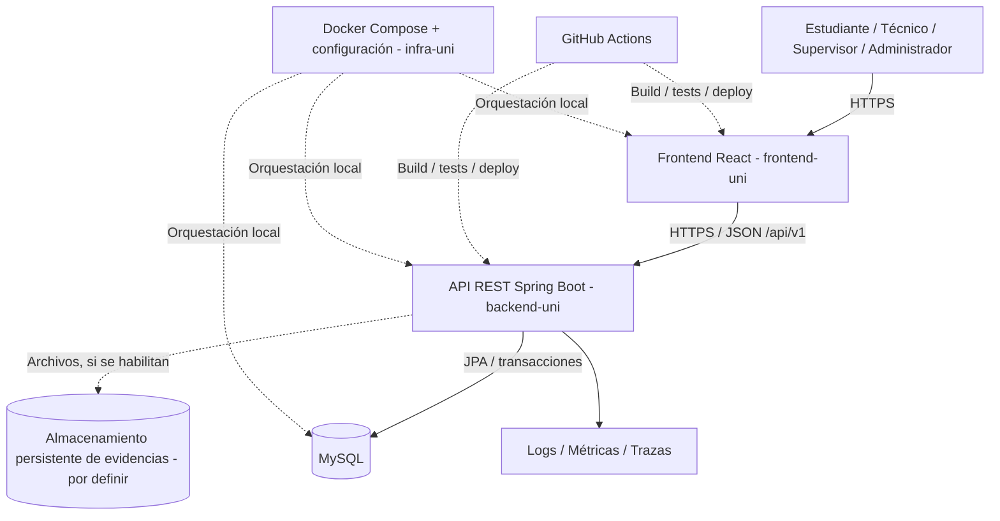

# ARCHITECTURE.md — Sistema Web Inteligente para la Gestión Integral de Servicios Universitarios

> **Estado:** Base de desarrollo presente en código y configuración; arquitectura funcional objetivo pendiente. Ejecución no verificada en esta revisión.  
> **Ubicación canónica:** `infra-uni/docs/ARCHITECTURE.md`.  
> **Última actualización:** 2026-11-02.  
> **Propósito:** Dar al equipo y a los agentes de IA una referencia compartida sobre límites, componentes, datos, seguridad y despliegue. **Actualizar cuando cambie una decisión aprobada o el código real.**

**Origen de requisitos:** documento académico «Sistema Web Inteligente para la Gestión Integral de Servicios Universitarios» (11 páginas). Las tecnologías React, Spring Boot y MySQL, los cinco módulos mínimos y el ciclo de 16 semanas proceden de esa propuesta. La separación en tres repositorios, arquitectura modular y plataformas de despliegue son **decisiones/propuestas del equipo**, no obligaciones del PDF.

**Regla para agentes:** este archivo explica *cómo se organiza el sistema*, no sustituye las historias de usuario ni el contrato de API. No dar por implementado ningún componente descrito aquí hasta comprobarlo en el repositorio. Si surge un conflicto entre documentos, detener la modificación, señalar la contradicción y solicitar una decisión registrada en un ADR.

## 1. Documentación y límites de propiedad

Los tres repositorios Git son independientes y se clonan como carpetas hermanas. La arquitectura se distribuye por responsabilidad:

| Referencia | Propiedad |
| --- | --- |
| [Frontend](../../frontend-uni/ARCHITECTURE.md) | Estructura React, componentes, sesión, consumo de API y pruebas UI |
| [Backend](../../backend-uni/ARCHITECTURE.md) | Módulos Spring Boot, API, reglas de negocio, seguridad y persistencia |
| Este documento | Visión global, integración, infraestructura, despliegue y decisiones compartidas |

```text
universidad-sm/                  # Agrupación local, no otro repositorio
├── frontend-uni/
│   ├── AGENTS.md
│   ├── ARCHITECTURE.md          # Arquitectura interna del frontend
│   ├── DESIGN.md
│   ├── Dockerfile.dev
│   └── src/
├── backend-uni/
│   ├── AGENTS.md
│   ├── ARCHITECTURE.md          # Arquitectura interna del backend
│   ├── Dockerfile.dev
│   └── src/
└── infra-uni/
    ├── AGENTS.md
    ├── compose.yaml
    ├── .env.example
    ├── iniciar.bat
    ├── detener.bat
    ├── DISEÑO-BD.md
    └── docs/
        ├── ARCHITECTURE.md      # Visión global y arquitectura de infraestructura
        ├── DOCKER.md
        ├── EPICS.md
        ├── requirements/
        │   ├── Gestal_Requisitos_Funcionales.md
        │   ├── Gestal_Requisitos_No_Funcionales.md
        │   └── user-stories/
        └── superpowers/plans/
```

**Estado observado:** existen la pantalla inicial React, la API mínima de estado, configuración de datasource/Actuator y Compose de desarrollo. No hay módulos de negocio ni esquema implementado. La presencia de archivos no prueba el arranque de servicios; consultar las limitaciones de verificación en [DOCKER.md](DOCKER.md).

**Límites de propiedad:** frontend posee interfaz y pruebas UI; backend posee reglas de negocio, autorización, esquema MySQL y OpenAPI; infraestructura posee documentación global, Compose, operación y evidencias. No crear `common/` entre repositorios ni copiar entidades Java al frontend. El intercambio es HTTP/JSON y contrato OpenAPI, todavía pendiente. Cada repositorio tendrá su propio CI, historial y control de acceso.

Las estructuras internas futuras se documentan en los archivos locales. `docs/adr/`, `docs/superpowers/specs/`, `docs/testing/`, `docs/ai/AI_USAGE_LOG.md`, `docs/deliverables/`, `monitoring/`, `scripts/` y `.github/workflows/` son ubicaciones previstas; crearlas al incorporar su contenido. Las decisiones compartidas se mantienen aquí y las internas en el documento del repositorio propietario.

## 2. High-Level System Diagram



**Flujo crítico de negocio:** el solicitante inicia sesión → registra solicitud → la API valida permisos y campos → MySQL guarda solicitud con código único y estado `Nuevo` → supervisor evalúa/prioriza/asigna → técnico atiende y resuelve → supervisor cierra → frontend consulta seguimiento y dashboard. Cada transición autorizada deja historial persistente.

**Regla arquitectónica:** una sola aplicación Spring Boot desplegable (**monolito modular**), no microservicios. Los módulos internos no se comunican a través de HTTP entre sí. No introducir mensajerías, cachés distribuidas, GraphQL o API Gateway sin necesidad demostrada y ADR aprobado.

## 3. Componentes y persistencia

### 3.1. Aplicaciones

El [frontend](../../frontend-uni/ARCHITECTURE.md) posee la presentación y el [backend](../../backend-uni/ARCHITECTURE.md) implementará el monolito modular. Sus estructuras, dependencias, responsabilidades internas y pruebas se mantienen en sus respectivos documentos.

### 3.2. Infraestructura y documentación transversal

- **Nombre:** `infra-uni`.
- **Responsabilidad:** ejecutar el conjunto en local; mantener scripts de operación y documentación global; recopilar evidencias de Docker, CI/CD, seguridad, testing y observabilidad.
- **Tecnologías previstas:** Docker Compose, GitHub Actions y herramientas de observabilidad escogidas según viabilidad.
- **Límite:** `infra-uni` no implementa lógica de negocio ni almacena contraseñas. `compose.yaml` puede usar rutas relativas a `../frontend-uni` y `../backend-uni` cuando los tres repositorios están clonados como hermanos.

## 4. Almacenamiento y límites de confianza

MySQL es el motor exigido por la propuesta académica. Infraestructura provisiona el servicio y su persistencia; backend posee esquema, migraciones y acceso a los datos. React no consulta MySQL directamente. Consultar [persistencia del backend](../../backend-uni/ARCHITECTURE.md) y el [diseño relacional](../DISEÑO-BD.md).

La carga de adjuntos y su proveedor siguen pendientes: si se aprueban, los archivos requieren almacenamiento persistente y privado, con metadatos en MySQL y autorización de descarga en backend. No usar disco efímero para evidencias críticas.

No se requieren Redis, Elasticsearch, RabbitMQ ni una segunda base de datos para el MVP; cualquier adición exige necesidad demostrada y ADR.

## 5. External Integrations / APIs

| Integración | Finalidad | Método / estado |
| --- | --- | --- |
| Frontend ↔ backend | Operaciones del sistema | REST/JSON sobre HTTPS, contrato OpenAPI; **interna al proyecto** |
| Vercel (candidato) | Publicar frontend | Integración Git/deploy; pendiente de configurar |
| Render (candidato) | Publicar contenedor backend | Docker/deploy; pendiente de configurar |
| Proveedor MySQL | Persistencia en entorno de demo | Servicio compatible MySQL; **proveedor por decidir** |
| Almacenamiento de archivos | Evidencias, si se implementan | API/SDK del proveedor; **por decidir** |
| Servicio de alertas | Avisos técnicos sobre salud | Canal/proveedor por decidir |

**Fuera de alcance inicial:** pagos, chatbots con LLM, servicios externos de mensajería, API Gateway y microservicios. Las notificaciones internas y reservas de ambientes se consideran extensiones solo si las historias aprobadas las incorporan. El uso de IA durante el desarrollo **sí exige** su registro documental, pero no exige integrar un chatbot en el producto.

## 6. Deployment & Infrastructure

**Entornos:** `local` (desarrollo), `staging` (pruebas integradas) y `production/demo` (sustentación). Cada uno tendrá configuración y datos separados. Nunca usar información personal real para pruebas o demos.

**Configuración local existente:** `compose.yaml` define `frontend`, `backend` y `mysql`, con arranque condicionado por salud: MySQL → backend → frontend. Vite publica `127.0.0.1:3000` y reenvía `/api` al backend; este publica `127.0.0.1:8080`. MySQL no publica puerto al host. `app_net` conecta frontend/backend y `db_internal` es interna, solo para backend/MySQL.

`mysql_data` persiste datos; `backend_target`, `maven_cache` y `frontend_node_modules` conservan artefactos y dependencias de desarrollo. MySQL tiene límite de 1 CPU y 1 GiB. Los Dockerfiles de desarrollo pertenecen a cada aplicación. No eliminar volúmenes persistentes sin autorización explícita.

Para iniciar, clonar los tres repositorios hermanos, abrir Docker Desktop y ejecutar `iniciar.bat`; crea `.env` desde `.env.example` si falta y ejecuta Compose. `detener.bat` detiene sin borrar datos. Procedimiento, configuración y límites de verificación: [README](../README.md) y [DOCKER.md](DOCKER.md). No se ha verificado ejecución en esta revisión documental.

**CI/CD objetivo por repositorio (aún sin workflows):**

- Frontend: dependencias → lint → pruebas → build → despliegue de preview/staging → smoke/E2E cuando aplique.
- Backend: compilación → unitarias → integración con MySQL de prueba → análisis estático/dependencias → imagen Docker → staging → smoke tests.
- Infra: validación de sintaxis Compose, escaneo/configuración y verificación de scripts; cambios de producción con revisión.
- `main` protegida, Pull Requests revisados, secretos solo en GitHub Secrets/gestores de secretos; nunca en artefactos o logs.

**Promoción a producción:** solo después de pruebas de aceptación, controles de seguridad y aprobación. Definir procedimiento de rollback, backup y restauración antes de sustentación.

**Observabilidad mínima:** Spring Actuator/Micrometer para salud y métricas, logs estructurados, identificador de correlación y trazas (OpenTelemetry es una opción expresamente mencionada por la propuesta). Alertas por indisponibilidad y errores anómalos; proteger endpoints de administración/actuator.

## 7. Seguridad transversal

Backend es responsable de autenticación, RBAC y controles por recurso, validación, auditoría y protección de datos. Frontend aplica la experiencia de sesión y permisos sin sustituir controles del servidor. Los detalles están en las arquitecturas locales.

Infraestructura gestiona aislamiento de redes, configuración por entorno, secretos y persistencia. Nunca versionar `.env` ni credenciales reales. La configuración local usa HTTP y conexión MySQL sin TLS dentro de Docker; no extrapolarla a producción, donde se requiere HTTPS/TLS y revisión de credenciales y acceso.

JWT de corta duración en memoria es una propuesta inicial; JWT frente a sesión sigue pendiente de ADR. Si se añaden cookies, coordinar CSRF, CORS, `HttpOnly`, `Secure` y SameSite entre repositorios. Los adjuntos y endpoints operativos requieren autorización. No registrar tokens, contraseñas ni información sensible innecesaria.

## 8. Development & Testing Environment

**Configuración local:** los tres repositorios se ejecutan con Docker Desktop y Compose según `infra-uni/README.md`; el host solo requiere Git y Docker Desktop, no Java, Maven, Node.js ni MySQL. La configuración actual fija React 19.3.0, Vite 8.3.5, Java 21, Spring Boot 4.1.2, Maven 3.9.16 y MySQL 8.4.13. Vite aplica HMR en cambios del frontend; para código Java, Maven compila dentro del contenedor y Spring Boot DevTools reinicia al detectar las clases compiladas.

**Pruebas por capa:**

| Capa / propósito | Herramientas propuestas | Evidencia esperada |
| --- | --- | --- |
| Reglas de negocio | JUnit 5 + Mockito | Transiciones, permisos, validaciones |
| Persistencia/API | Spring Boot Test + Testcontainers MySQL | Migraciones, transacciones, códigos HTTP |
| UI React | Vitest + Testing Library | Formularios, carga, error y estados vacíos |
| Flujo integral | Playwright | Login → crear → asignar → resolver → cerrar |
| Calidad estática | ESLint, análisis Java y dependencias | Reportes CI reproducibles |
| Seguridad | SAST y OWASP ZAP sobre entorno autorizado | Informe de hallazgos y correcciones |
| Rendimiento | k6 | Carga, estrés, latencia, tasa de error |
| Aceptación | Historias HU + escenarios BDD | Matriz HU → PR → test → evidencia |

**Definition of Done por historia:** especificación aprobada, test relevante creado y ejecutado, cambio de código revisado, endpoint/documentación actualizada si aplica, evidencia guardada y registro de uso de IA cuando corresponda. **No afirmar que las pruebas pasan sin ver su salida.**

**Trabajo con agentes IA:** `AGENTS.md` define reglas de trabajo, `.agents/skills/` define procedimientos, `DESIGN.md` define UI y las HU individuales definen comportamiento funcional. Un agente debe localizar y leer la HU exacta antes de modificar código. Acceso a otro repositorio **no es automático**: proporcionar workspace multirrepositorio, rutas montadas o una copia explícita del contexto autorizado. No permitir que el agente invente endpoints, requisitos o dependencias no aprobadas.

## 9. Future Considerations / Roadmap

**Semanas 1–4 (Fase I):** definición y aprobación de requisitos, épicas, HU individuales, BDD, arquitectura, modelo ER y `DESIGN.md`; primer frontend con mocks.

**Semanas 5–10 (Fase II):** Spring Boot, MySQL, login, solicitudes, asignación, gestión de estados, administración y dashboard; en semana 10 debe existir un **MVP end-to-end** y el informe parcial.

**Semanas 11–13 (Fase III):** documentación OpenAPI, Docker, cloud, entornos, CI/CD, controles OWASP, automatización y release candidate.

**Semanas 14–16 (Fase IV):** pruebas de aceptación/usuario/seguridad/carga/estrés, logs/métricas/trazas, correcciones, manuales y **sustentación con demostración real** en semana 16.

**Posibles extensiones, nunca automáticas:** notificaciones internas, reservas de ambientes, recuperación de contraseña y mejoras de tiempo real. Un chatbot con IA no es un módulo obligatorio del PDF. No migrar a microservicios sin restricciones técnicas verificadas.

**Decisiones pendientes que requieren ADR:** proveedor y costo de MySQL cloud; elección definitiva JWT/sesión; almacenamiento de adjuntos; regla exacta de fechas límite y KPI de vencidas; política de cierre/reapertura; retención de logs; validación de las versiones fijadas actualmente en los manifiestos.

## 10. Project Identification

| Campo | Valor |
| --- | --- |
| Nombre | Sistema Web Inteligente para la Gestión Integral de Servicios Universitarios |
| Organización GitHub | taller-web-sigesu; estado remoto no verificado |
| Repositorio frontend | `frontend-uni` — https://github.com/taller-web-sigesu/frontend-uni |
| Repositorio backend | `backend-uni` — https://github.com/taller-web-sigesu/backend-uni |
| Repositorio infraestructura | `infra-uni` — https://github.com/taller-web-sigesu/infra-uni |
| Equipo | Grupo académico de cinco integrantes |
| Responsable técnico/contacto | Por asignar por el equipo |
| Fuente del alcance | PDF de propuesta del curso, 11 páginas |
| Estado de implementación | Base de desarrollo en código; módulos funcionales pendientes |
| Última actualización | 2026-11-02 |

**Gobernanza de cambios:** toda decisión arquitectónica relevante se registra en `infra-uni/docs/adr/ADR-XXXX-descripcion.md`, enlaza las historias afectadas y se revisa por al menos otro integrante. Al implementar un módulo, corregir este documento para diferenciar intención de realidad. Revisarlo en cada entrega parcial y final.

## 11. Glossary / Acronyms

| Término | Significado |
| --- | --- |
| **API REST** | Interfaz HTTP basada en recursos utilizada para conectar frontend y backend. |
| **BDD** | Behavior-Driven Development: criterios de comportamiento en escenarios Dado/Cuando/Entonces. |
| **HU** | Historia de usuario; archivo de requisito funcional identificable, con criterios de aceptación. |
| **MVP** | Producto mínimo viable demostrable de extremo a extremo. |
| **RBAC** | Role-Based Access Control; autorización por roles, complementada por permisos sobre recursos. |
| **JWT** | JSON Web Token; posible mecanismo de autenticación, no obligatorio frente a sesiones. |
| **DTO** | Data Transfer Object; estructura de entrada/salida de la API. |
| **JPA** | Jakarta Persistence API; interfaz de persistencia relacional usada con Spring Data. |
| **CI/CD** | Integración continua y entrega/despliegue continuo. |
| **SAST / DAST** | Análisis de seguridad estático / dinámico. |
| **OpenAPI** | Especificación formal y versionada del contrato HTTP. |
| **ADR** | Architectural Decision Record; documento breve que registra una decisión técnica, alternativas y consecuencias. |
| **Registro de IA** | Evidencia de prompts, resultados, validaciones, modificaciones y responsables del desarrollo asistido por IA. |

---

### Reglas de lectura para agentes (resumen)

1. Leer `AGENTS.md`, el `ARCHITECTURE.md` del repositorio activo y esta arquitectura global.
2. Leer la HU individual, requisitos y criterios BDD de la tarea; para UI, leer también `frontend-uni/DESIGN.md`.
3. Para contratos REST y datos, consultar la arquitectura del backend y `infra-uni/DISEÑO-BD.md`; OpenAPI, `docs/DATABASE.md` y migraciones son referencias previstas hasta que se implementen.
4. No considerar como existente ninguna carpeta o endpoint de la arquitectura objetivo sin verificar el código.
5. Si un cambio atraviesa repositorios, coordinar contratos, revisiones y pruebas de integración antes de darlo por cerrado.
6. Mantener este documento y el registro de uso de IA actualizados; no añadir funcionalidades fuera de alcance sin aprobación.
