

# Manual de usuario

**Gestal / UniService**  
Sistema Web para la Gestión Integral de Servicios Universitarios

Versión `v1.0.0` · 22/11/2026

Grupo 3 · Taller de construcción de software web · UNMSM, FISI, 2026-II

## 1. Introducción

Gestal permite a la comunidad universitaria **reportar incidencias o pedir servicios** (soporte informático, mantenimiento, biblioteca y servicios generales) y **reservar ambientes** (laboratorios, aulas, auditorio, salas y cancha). Cada solicitud tiene un código único, un responsable y un historial visible desde que se registra hasta que se cierra.

Este manual explica qué puede hacer cada rol y cómo hacerlo paso a paso.

### 1.1 Cómo entrar

| Entorno | Dirección |
| :---- | :---- |
| Producción | <https://frontend-uni-wx9m.vercel.app> |
| Staging (pruebas y demo) | <https://frontend-uni-tdk7.vercel.app> |
| Local (Docker) | <http://localhost:3000> |

Se recomienda usar la versión actual de Chrome, Edge, Firefox o Safari. La interfaz se adapta a pantallas de celular.

### 1.2 Roles

| Rol | Qué hace |
| :---- | :---- |
| **Estudiante** | Registra y sigue sus solicitudes, comenta, adjunta evidencias, califica la atención y reserva ambientes. |
| **Docente** | Igual que el estudiante. |
| **Técnico** | Atiende las solicitudes que le asignan y actualiza su estado. |
| **Supervisor** | Gestiona las solicitudes de su área: asigna técnico, ajusta prioridad, cierra o rechaza. Aprueba reservas de los ambientes de su área. Consulta indicadores. |
| **Administrador** | Gestiona usuarios, catálogos, políticas SLA y ambientes. Aprueba reservas y consulta indicadores de todas las áreas. |

### 1.3 Cuentas de demostración

Disponibles solo en **staging** y en el entorno **local**. Todas usan la contraseña `Demo2026!`. Producción no tiene cuentas demo.

| Correo | Rol |
| :---- | :---- |
| `ana.demo@universidad.example` | Estudiante |
| `pedro.demo@universidad.example` | Docente |
| `tecnico.ti.demo@universidad.example` | Técnico de Soporte Informático |
| `tecnico.sg.demo@universidad.example` | Técnico de Servicios Generales |
| `supervisor.ti.demo@universidad.example` | Supervisor de Soporte Informático |
| `supervisor.sg.demo@universidad.example` | Supervisor de Servicios Generales |
| `admin.demo@universidad.example` | Administrador |

> Las capturas de este manual se tomaron en el entorno local con estas cuentas ficticias. Algunos detalles visuales, como el nombre de la institución en la cabecera, cambian con las mejoras de UI/UX de la Fase IV, descritas en `ANEXO-MEJORAS-UI-UX.pdf`. Los flujos son los mismos.

## 2. Acceso al sistema

### 2.1 Iniciar sesión

1. Abre la dirección del sistema. Aparece la pantalla **Iniciar sesión**.
2. Escribe tu **correo institucional** y tu **contraseña**. El ícono del ojo muestra u oculta la contraseña.
3. Pulsa **Ingresar**.

El sistema te lleva a tu pantalla de inicio. Para el supervisor, es **Indicadores**.

<figure>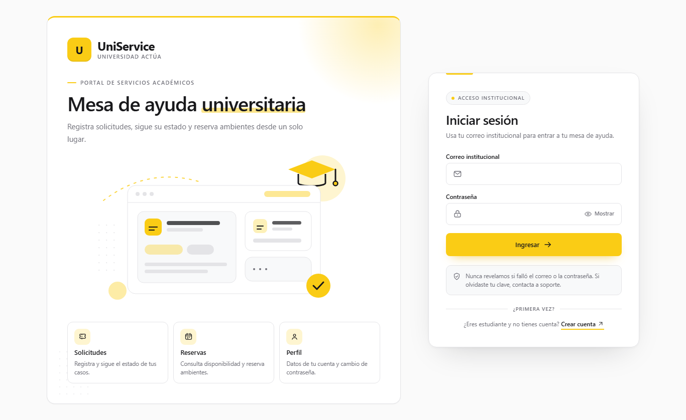<figcaption>Figura 1. Inicio de sesión.</figcaption></figure>

**Reglas de la sesión**

- **Una sesión por cuenta.** Si inicias sesión en otro navegador o dispositivo, la sesión anterior se cierra. Al volver a ella, el sistema te pide iniciar sesión de nuevo.
- Tras **cinco intentos fallidos** con el mismo correo, el sistema bloquea temporalmente nuevos intentos. Espera unos minutos.
- Si el administrador creó tu cuenta o restableció tu contraseña, el sistema te pide **cambiar la contraseña** al primer ingreso.

### 2.2 Crear una cuenta (estudiantes)

1. En la pantalla de ingreso, pulsa **Crear cuenta**.
2. Completa tu nombre completo, tu correo institucional, una contraseña y su confirmación.
3. Pulsa **Registrarme**. La cuenta queda **pendiente de aprobación**.
4. Podrás ingresar cuando el administrador la apruebe.

<figure>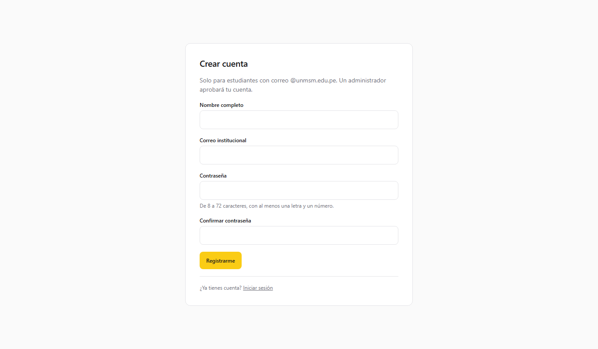<figcaption>Figura 2. Registro de una cuenta de estudiante.</figcaption></figure>

### 2.3 Perfil y cambio de contraseña

En el menú **Perfil** puedes ver tus datos y cambiar tu contraseña. Al cambiarla, las demás sesiones abiertas se cierran.

<figure>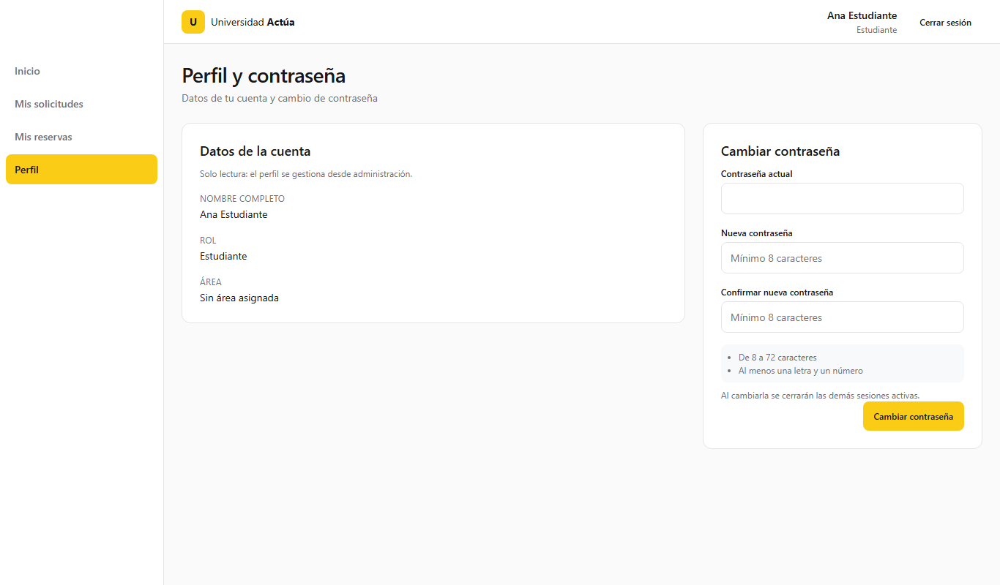<figcaption>Figura 3. Perfil.</figcaption></figure>

### 2.4 Cerrar sesión

Pulsa **Cerrar sesión**. Hazlo siempre en computadoras compartidas.

## 3. Estudiante y docente

El estudiante y el docente tienen el mismo menú: **Inicio**, **Mis solicitudes**, **Mis reservas** y **Perfil**.

<figure>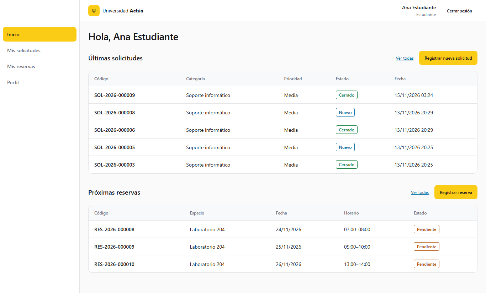<figcaption>Figura 4. Inicio del estudiante.</figcaption></figure>

### 3.1 Registrar una solicitud

1. Entra a **Mis solicitudes** y pulsa **Registrar nueva solicitud**.
2. Elige la **categoría**. La categoría define el área que atenderá la solicitud.
3. Indica la **ubicación**, por ejemplo «Pabellón B, aula 204», y **describe** el problema.
4. Si quieres, adjunta fotos o documentos como evidencia.
5. Pulsa **Registrar solicitud**. El sistema asigna un código como `SOL-2026-000010` y el estado **Nuevo**.

<figure>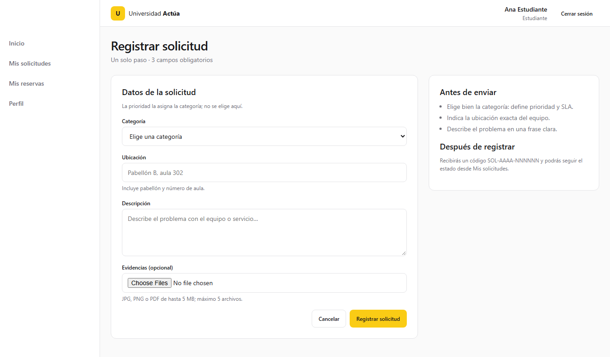<figcaption>Figura 5. Registro de una solicitud.</figcaption></figure>

> Elige bien la categoría. Si el área que recibe el reporte no corresponde, el supervisor lo **rechaza** e indica la categoría correcta. En ese caso, registra una nueva solicitud con esa categoría. Puedes citar el código anterior en la descripción.

### 3.2 Consultar mis solicitudes

**Mis solicitudes** lista tus solicitudes con su código, categoría, prioridad, estado y fecha. Pulsa una fila para abrir el detalle.

<figure>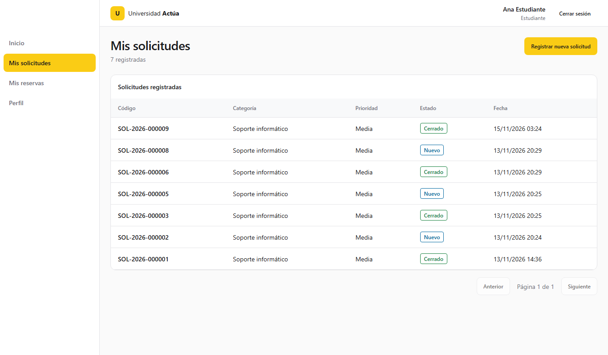<figcaption>Figura 6. Mis solicitudes.</figcaption></figure>

**Estados de una solicitud**

| Estado | Significado |
| :---- | :---- |
| Nuevo | Registrada. El supervisor del área aún no la asigna. |
| Asignado | Tiene un técnico responsable. |
| En proceso | El técnico está trabajando en ella. |
| Resuelto | El técnico terminó. El supervisor debe revisarla y cerrarla. |
| Cerrado | Atención terminada. Puedes calificarla. |
| Rechazado | El supervisor la rechazó e indicó el motivo, por ejemplo un duplicado o una categoría equivocada. |

### 3.3 Detalle, historial, comentarios y evidencias

El detalle muestra los datos de la solicitud, el responsable, los plazos de atención (SLA), el **historial** de cambios de estado y los **comentarios**.

- **Comentar:** escribe en el cuadro **Comentario** y pulsa **Publicar comentario**.
- **Adjuntar evidencias:** archivos JPG, PNG o PDF de hasta 5 MB, con un máximo de cinco por solicitud.
- **Descargar** una evidencia con el botón **Descargar**.
- **Calificar:** cuando la solicitud está **Cerrada**, responde la encuesta de satisfacción. Se responde una vez por solicitud.

<figure>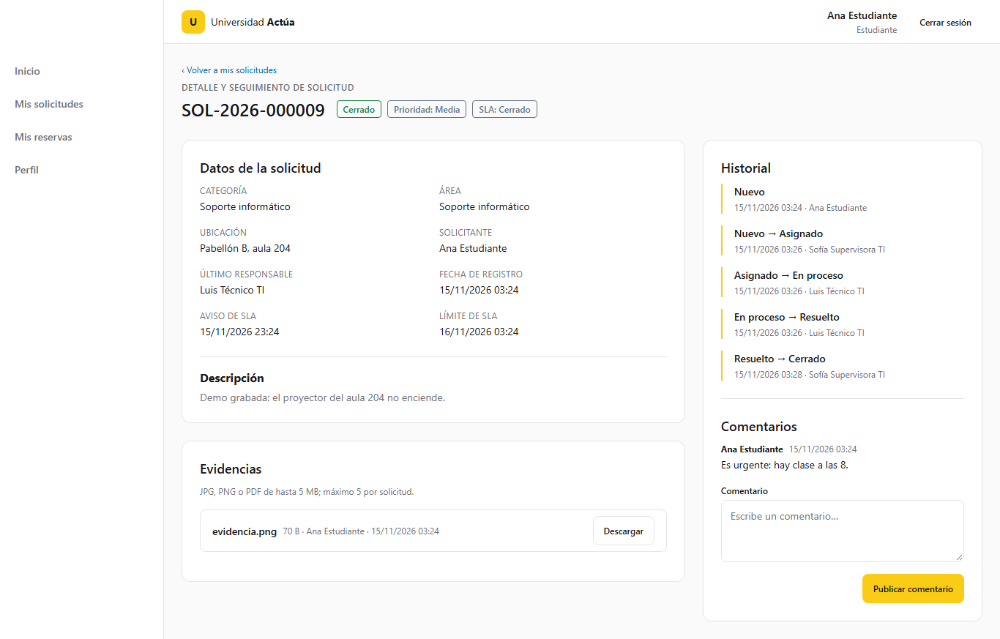<figcaption>Figura 7. Detalle, historial y comentarios de una solicitud.</figcaption></figure>

### 3.4 Reservar un ambiente

1. Entra a **Mis reservas** y pulsa el botón para registrar una nueva reserva. Se abre **Reservar ambiente**.
2. Filtra por tipo de espacio, pabellón, capacidad mínima y **fecha**.
3. En **Espacios disponibles**, pulsa **Elegir** en el espacio que quieras. Puedes elegir, por ejemplo, **Laboratorio 10** o **Cancha deportiva**.
4. Indica la **hora de inicio**, la **hora de fin**, el **motivo** y, si quieres, los asistentes.
5. Pulsa **Registrar reserva**. La reserva queda **Pendiente** hasta que el supervisor del área o el administrador la apruebe o la rechace.

<figure>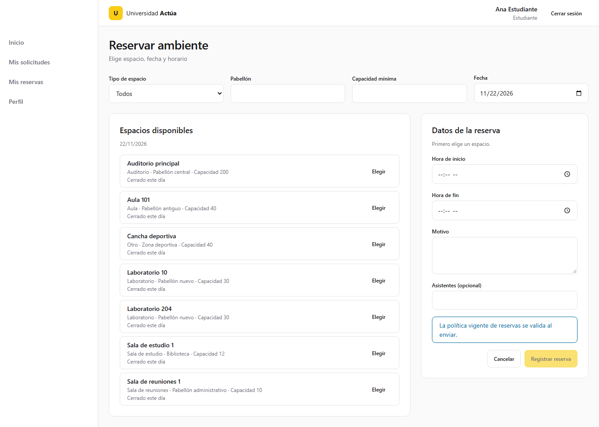<figcaption>Figura 8. Reserva de un ambiente.</figcaption></figure>

Los ambientes atienden en su horario, por ejemplo de lunes a viernes de 07:00 a 22:00. El sistema rechaza las reservas fuera de ese horario o que se cruzan con otra aprobada.

### 3.5 Consultar y cancelar mis reservas

**Mis reservas** muestra el estado de cada reserva: Pendiente, Aprobada, Rechazada o Cancelada. Abre una reserva para ver su detalle. Puedes **cancelarla** antes de la hora de inicio.

<figure>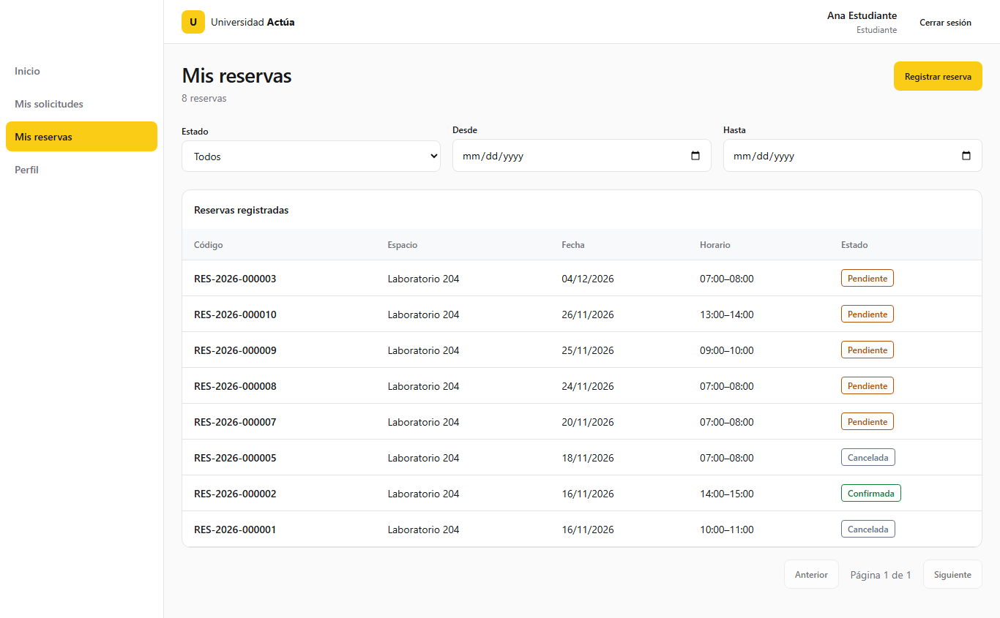<figcaption>Figura 9. Mis reservas.</figcaption></figure>

## 4. Técnico

Menú: **Inicio**, **Mis asignaciones**, **Mis reservas** y **Perfil**.

### 4.1 Mis asignaciones

La bandeja muestra las solicitudes que tienes asignadas, ordenadas por prioridad y antigüedad.

<figure>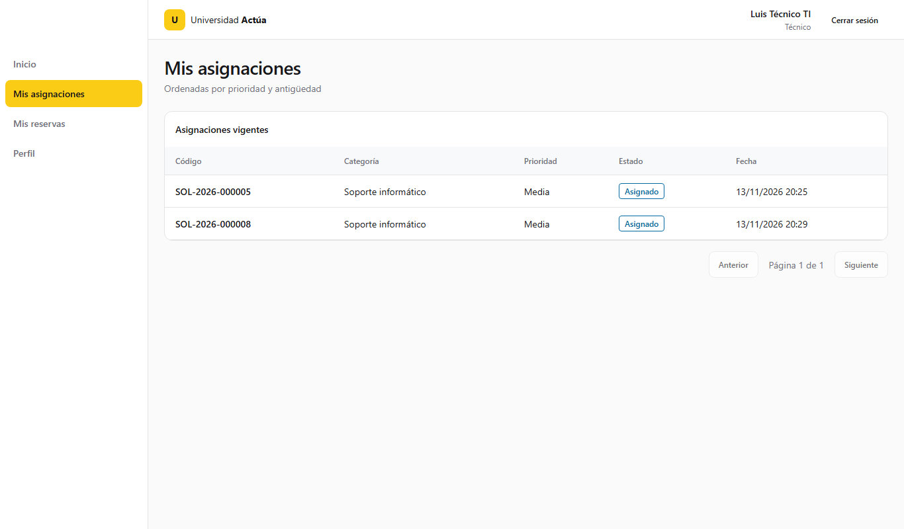<figcaption>Figura 10. Mis asignaciones.</figcaption></figure>

### 4.2 Atender una solicitud

1. Abre la solicitud desde la bandeja.
2. Pulsa **Iniciar atención**. El estado pasa a **En proceso**.
3. Registra comentarios o adjunta evidencias del trabajo, si corresponde.
4. Al terminar, pulsa **Marcar como resuelta**. El estado pasa a **Resuelto** y el supervisor la revisa.

<figure>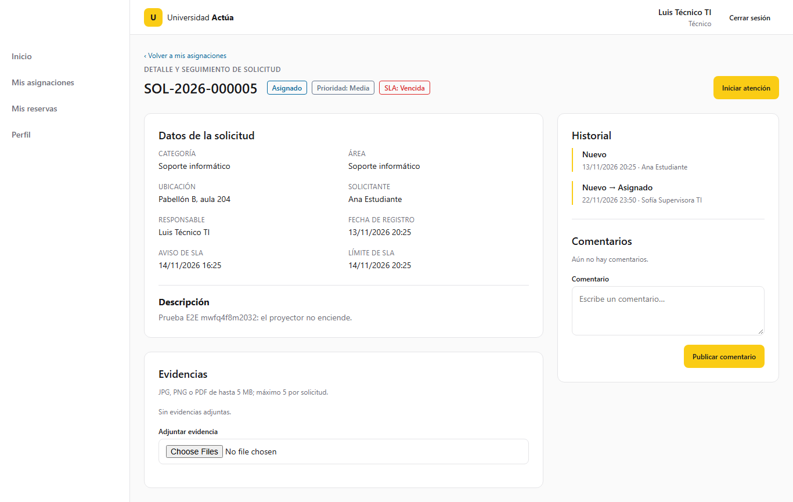<figcaption>Figura 11. Solicitud asignada al técnico.</figcaption></figure>

> Si el plazo de atención venció, el detalle muestra la etiqueta **SLA: Vencida**.

## 5. Supervisor

Menú: **Indicadores**, **Gestión de área**, **Aprobación de reservas**, **Mis reservas** y **Perfil**. El supervisor solo ve las solicitudes y los ambientes de **su área**.

### 5.1 Indicadores

Muestra las solicitudes registradas, pendientes, atendidas y vencidas, el promedio de atención, el porcentaje resuelto y la distribución por categoría, prioridad y técnico. Cambia el rango con **Desde** y **Hasta** y pulsa **Aplicar**. Puedes **exportar** las solicitudes o los indicadores en CSV.

<figure>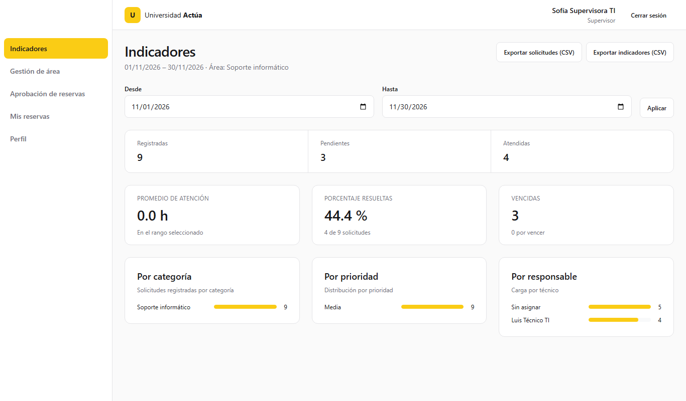<figcaption>Figura 12. Indicadores del área.</figcaption></figure>

### 5.2 Gestión de área

Lista las solicitudes del área con filtros por estado, categoría y prioridad.

<figure>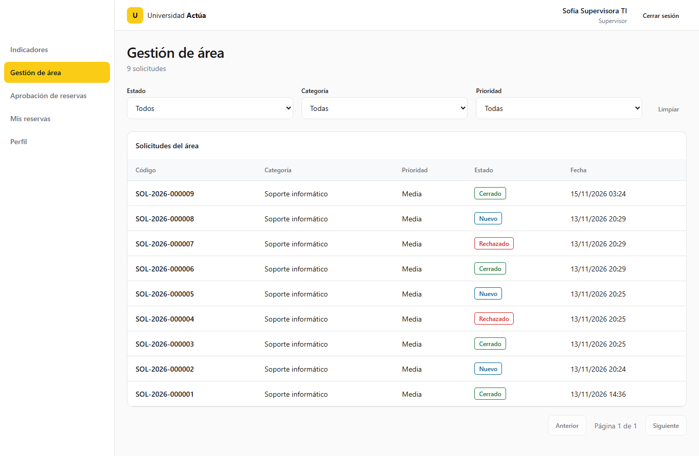<figcaption>Figura 13. Gestión de área.</figcaption></figure>

En el detalle de una solicitud, el supervisor puede:

- **Asignar o reasignar** un técnico habilitado de su área.
- **Ajustar la prioridad**.
- **Cerrar** una solicitud resuelta.
- **Rechazar** una solicitud con un motivo, por ejemplo por estar **duplicada** o por pertenecer a **otra área**. En el segundo caso, indica la categoría correcta en el motivo.
- Consultar la **auditoría** de cambios.

<figure>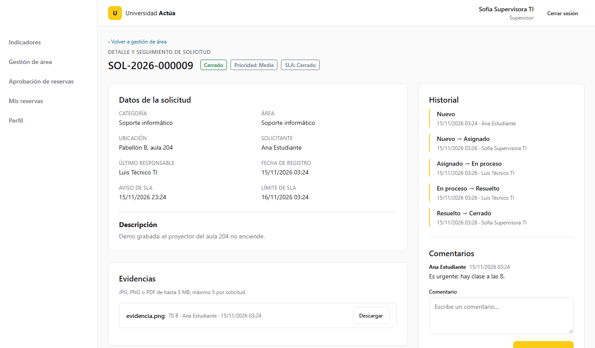<figcaption>Figura 14. Detalle de una solicitud desde la gestión de área.</figcaption></figure>

**Reglas.** No se puede asignar un técnico de otra área. El sistema no transfiere solicitudes entre áreas: el reporte mal dirigido se rechaza y el solicitante registra uno nuevo.

### 5.3 Aprobación de reservas

Lista las reservas pendientes de los ambientes del área. Pulsa **Revisar** para aprobar o rechazar una reserva. Para rechazar, indica el motivo. No puedes aprobar tus propias reservas.

<figure>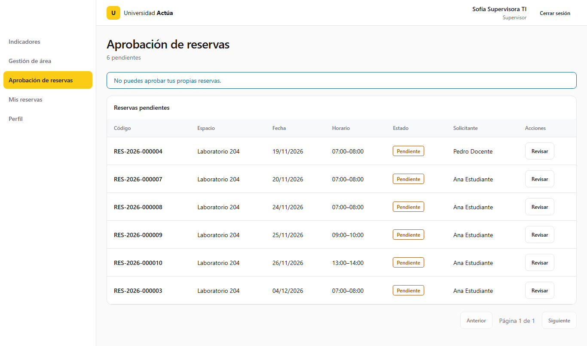<figcaption>Figura 15. Aprobación de reservas.</figcaption></figure>

## 6. Administrador

Menú: **Inicio**, **Indicadores**, **Usuarios**, **Catálogos**, **SLA**, **Ambientes**, **Aprobación de reservas** y **Perfil**.

<figure>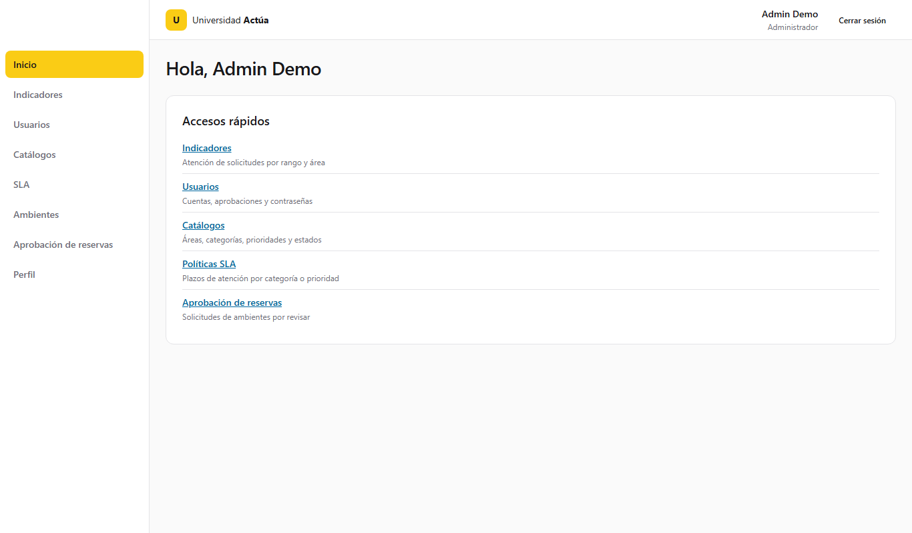<figcaption>Figura 16. Inicio del administrador con accesos rápidos.</figcaption></figure>

### 6.1 Usuarios

- **Crear usuario:** nombre, correo, rol y área (obligatoria para técnicos y supervisores).
- **Editar** los datos y el rol.
- **Desactivar o activar** una cuenta. Una cuenta desactivada no puede iniciar sesión.
- **Restablecer contraseña.** El usuario debe cambiarla al siguiente ingreso.
- La pestaña **Pendientes de aprobación** lista los registros de estudiantes para **aprobarlos o rechazarlos**.

<figure>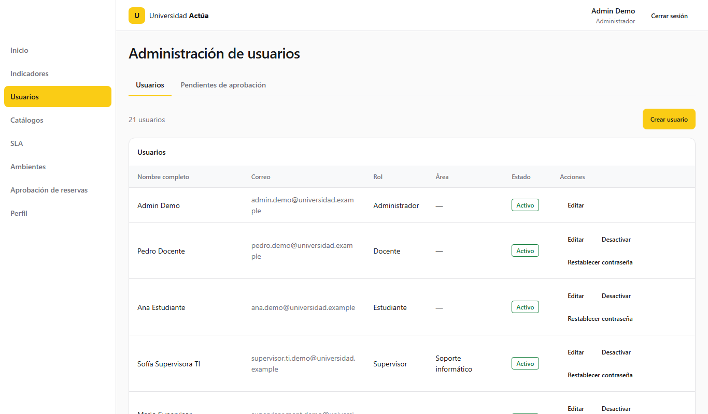<figcaption>Figura 17. Administración de usuarios.</figcaption></figure>

### 6.2 Catálogos

Administra las **áreas**, las **categorías**, las **prioridades** y los **nombres de los estados**. Cada categoría pertenece a un área. Los elementos en uso se **desactivan** en lugar de borrarse.

<figure>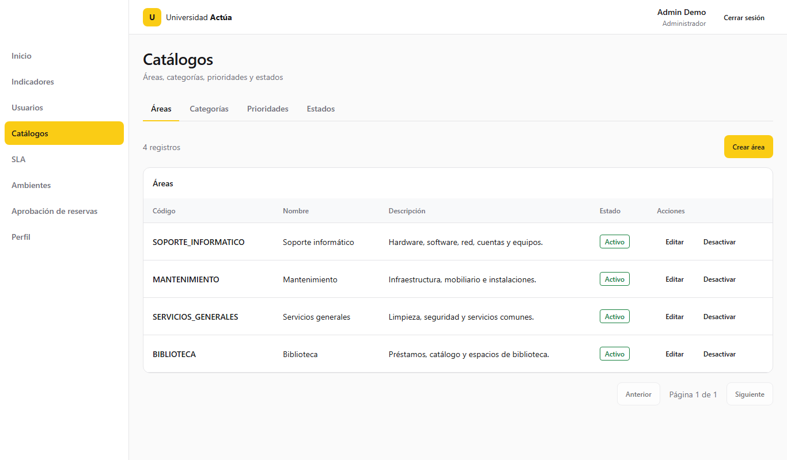<figcaption>Figura 18. Catálogos.</figcaption></figure>

### 6.3 Políticas SLA

Define los plazos de aviso y de vencimiento por categoría o prioridad. Las solicitudes nuevas calculan sus fechas límite con la política vigente.

<figure>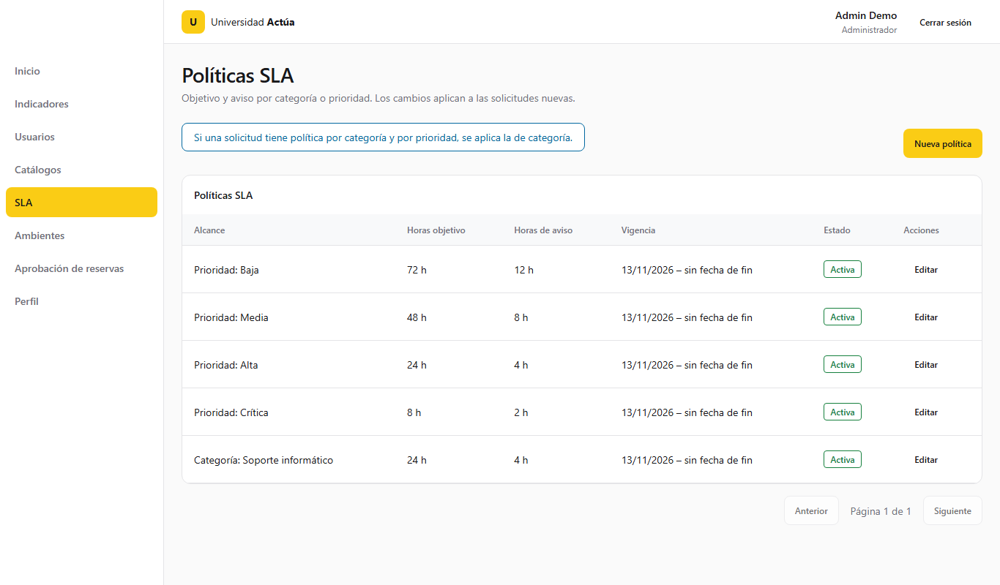<figcaption>Figura 19. Políticas SLA.</figcaption></figure>

### 6.4 Ambientes

Crea y edita espacios: tipo, área responsable, pabellón, capacidad y horario por día. Configura también la política de reservas.

<figure>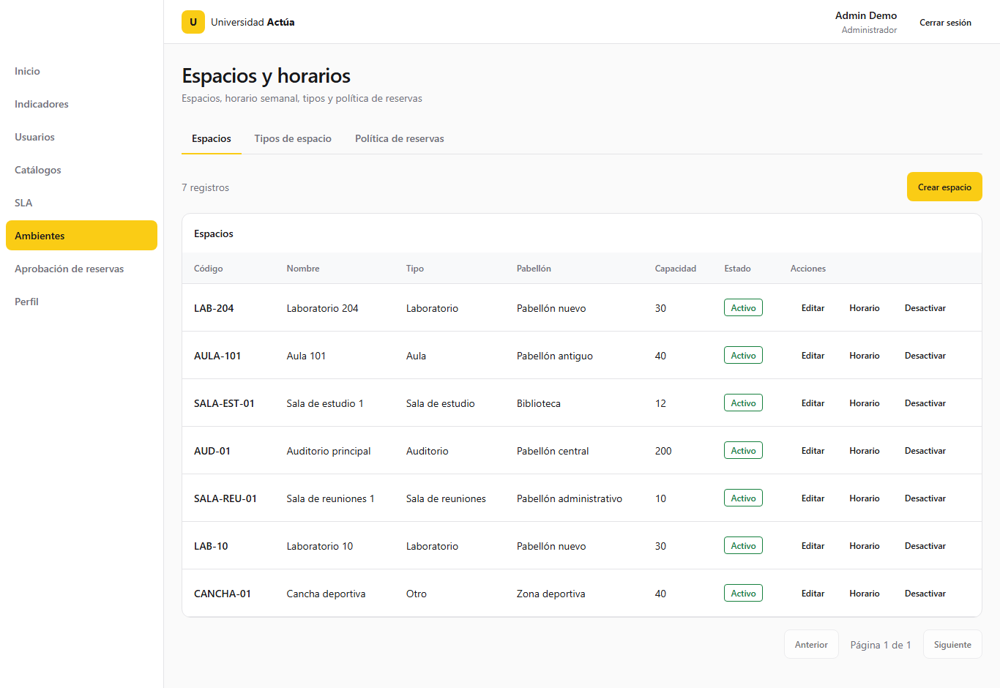<figcaption>Figura 20. Administración de ambientes.</figcaption></figure>

### 6.5 Indicadores y reservas

El administrador ve los indicadores de **todas las áreas** y puede aprobar o rechazar reservas de cualquier ambiente. El administrador **no asigna** solicitudes: esa tarea es del supervisor de cada área.

## 7. Preguntas frecuentes

**Me sacó del sistema sin cerrar sesión.**  
Iniciaste sesión con la misma cuenta en otro lugar o tu sesión caducó. Vuelve a iniciar sesión.

**No puedo ingresar después de registrarme.**  
Tu cuenta está pendiente. El administrador debe aprobarla.

**Olvidé mi contraseña.**  
Pide al administrador que la restablezca. El sistema no envía correos de recuperación.

**Mi solicitud fue rechazada por «otra área».**  
Registra una nueva solicitud con la categoría indicada en el motivo.

**¿Puedo transferir una solicitud a otra área?**  
No. El supervisor la rechaza con un motivo y el solicitante la registra de nuevo con la categoría correcta.

**No aparece el botón para calificar.**  
La encuesta solo aparece cuando la solicitud está **Cerrada** y aún no la calificaste.

**No puedo elegir un horario de reserva.**  
El ambiente está cerrado ese día u horario, o se cruza con otra reserva aprobada.

**El archivo no se adjunta.**  
Revisa que sea JPG, PNG o PDF, que pese 5 MB o menos y que la solicitud no tenga ya cinco evidencias.

## 8. Problemas conocidos

| Problema | Qué hacer |
| :---- | :---- |
| La primera carga de staging tarda hasta un minuto | El servidor gratuito de Render se suspende sin uso. Espera y recarga. |
| Las evidencias adjuntas en staging o producción desaparecen tras un reinicio del servidor | Usan almacenamiento temporal. Vuelve a adjuntarlas si es necesario. |
| No hay notificaciones por correo ni dentro de la aplicación | Revisa el estado de tus solicitudes y reservas en sus listados. |
| No hay reservas recurrentes | Registra una reserva por fecha. |

## 9. Soporte

Para reportar un error del sistema, abre un *issue* en el repositorio correspondiente de [taller-web-sigesu](https://github.com/taller-web-sigesu). Indica los pasos, la fecha, la hora y, si aparece, el identificador de correlación del error. No incluyas contraseñas.
